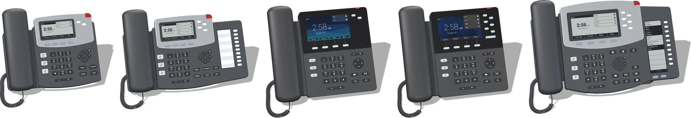
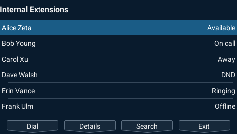
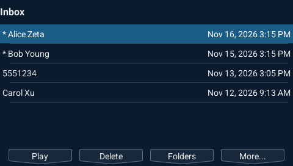
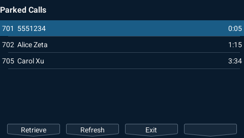
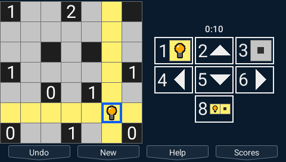
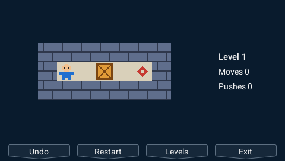
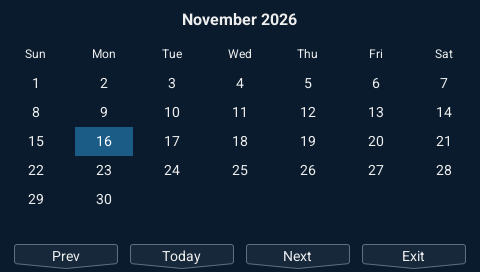

<p align="center">
  <a href="https://opendeskphone.org">
    <picture>
      <source media="(prefers-color-scheme: dark)" srcset="docs/src/assets/logo-dark.svg">
      
    </picture>
  </a>
</p>

<p align="center">
  Open-source firmware for the Digium D40, D45, D50, D60, D62, D65, and D70 desk phones.
</p>

<p align="center">
  <a href="https://opendeskphone.org"><b>opendeskphone.org</b></a>
  &nbsp;·&nbsp;
  <a href="https://opendeskphone.org/#installation">Install</a>
  &nbsp;·&nbsp;
  <a href="https://opendeskphone.org/open-dpma/">Open DPMA</a>
  &nbsp;·&nbsp;
  <a href="https://opendeskphone.org/app-sdk/">App SDK</a>
  &nbsp;·&nbsp;
  <a href="https://opendeskphone.org/dev-guide/">Dev Guide</a>
</p>

<p align="center">
  
</p>

Open Desk Phone is a mainline Linux 7.3 kernel, ported to the phones' Broadcom BCMRING processor, and `dphone`, one static Rust program that is init, the SIP phone, the user interface, the web interface, and the SSH server.  It installs from stock firmware as an ordinary firmware update, and stock firmware installs back the same way.

On Asterisk, the phones are provisioned over DPMA, by Digium's original `res_digium_phone` or by [Open DPMA](#open-dpma), the open replacement in this repository.  Without DPMA, add SIP accounts in the web interface.

- **Apps** are WebAssembly components, sandboxed, and installed from the web interface.  The stock firmware's JavaScript apps do not run.
- **Themes** on the D60, D62, and D65 pair a wallpaper with a color palette for every screen.  With Open DPMA, a user's theme follows the user to other phones.
- **The web interface** manages calls, Bluetooth headsets (D65), alarms, apps, and firmware, and mirrors the phone's screen, keys included.
- **A root shell** is available over SSH, on a serial console on the EHS port, and in the web interface.
- **Updates** from Open Desk Phone go to the inactive one of two firmware banks and boot on trial: if the new image does not come up, the phone goes back to the old one.  `dphone ramboot` boots an image from RAM without writing to flash.

## Install

Download `<version>_<model>_firmware.eff` for the phone's model, e.g., `3_0_0_D65_firmware.eff`, and `SHA256SUMS` from [Releases](https://github.com/jackrosenthal/opendeskphone/releases).  A phone refuses an image built for another model.  Then either:

- open `http://<phone address>/firmware/`, choose the file under **Firmware File**, and click **Update to this Firmware Version**, or
- add a firmware entry for the image to the PBX's DPMA configuration; the phones install it at their next configuration fetch.

The phone keeps its network settings and web interface password.  To go back, upload a stock image on the **System** page.

> [!CAUTION]
> Stock firmware records no trial boot, so if the first image it installs does not start, nothing returns the phone to stock firmware.  From stock firmware, install only released images.

The [full instructions](https://opendeskphone.org/#installation) cover phones that a DPMA server provisions.

## Open DPMA

`res_open_dpma.so` is a drop-in replacement, written in Rust, for Digium's closed-source DPMA module, for Asterisk 22, 23, and 24.  It reads the same `res_digium_phone.conf`, registers the same CLI commands and AMI actions, and restores the original module's saved sessions, so phones stay connected across the switch.  It provisions phones on stock firmware and on Open Desk Phone alike.  It supports PJSIP only.

It fixes bugs in the original module, among them:

- a phone file request with a `..` component reads any file the Asterisk process can read;
- any configuration token that begins with a phone section's name and the phone's MAC address is accepted, whatever `config_auth` says;
- several requests crash Asterisk.

Prebuilt modules for x86_64 and aarch64 are on the [releases page](https://github.com/jackrosenthal/opendeskphone/releases).  See [the documentation](https://opendeskphone.org/open-dpma/) and [`open-dpma/README.md`](open-dpma/README.md).

## Apps

<p align="center">
  
  
  
  
  
  
</p>

The built-in apps use the same [App SDK](https://opendeskphone.org/app-sdk/) as any other app; [`apps/`](apps/) has their source.  An app is one WebAssembly component that runs in a sandbox with a memory cap and gets only the phone interfaces its code imports.  The phone calls the app once at start and once per event, and whatever takes time returns at once and delivers its result as a later event, so an app never blocks the phone.  With Open DPMA, apps can keep data on the PBX that every phone shares.

```rust
use opendeskphone_app_sdk::prelude::*;

const SK_EXIT: u32 = 1;

#[derive(Default)]
struct Hello;

impl App for Hello {
    fn start(&mut self) {
        let area = screen("Hello");
        let text = ui::create(WidgetKind::Text, ROOT, area);
        ui::set_text(text, "Hello from an app.");
        ui::set_softkeys(ROOT, &[Softkey::new(SK_EXIT, "Exit")]);
    }

    fn handle(&mut self, event: Event) {
        if let Event::Softkey(SK_EXIT) = event {
            runtime::exit();
        }
    }
}

opendeskphone_app_sdk::export_app! {
    app: Hello,
    name: "hello",
    display_name: "Hello",
    description: "Says hello",
}
```

```sh
cargo build --release --target wasm32-unknown-unknown
wasm-tools component new target/wasm32-unknown-unknown/release/hello.wasm -o hello.wasm
```

Upload `hello.wasm` on the web interface's **Apps** page.  The [tutorial](https://opendeskphone.org/app-sdk/tutorial/) continues with softkeys, storage, drawing, and data shared between phones.

## Build

The build needs x86-64 Linux and [Nix](https://nixos.org/download/) with flakes; Nix provides the rest.  The first build downloads the Linux source and two stock firmware images: the voice DSP firmware is proprietary and not in this repository, so the build extracts it from the stock images.

```sh
nix build .#eff-d60    # ./result is 3_0_0_D60_firmware.eff
nix build .#all        # all seven models
nix flake check        # the tests, Clippy, and a JFFS2 mount test (needs /dev/kvm)
```

CI also uploads each model's image from every push as a workflow artifact, `firmware-<model>`.

The simulator runs the firmware on the workstation:

```sh
nix develop
cargo run -p opendeskphone -- main --sim --model d65 --nvdata /tmp/opendeskphone-sim
```

Its web interface is at `http://127.0.0.1:8080/` (user `admin`, password `789`), and the **Screen** page shows the display and takes key presses.  See the [Dev Guide](https://opendeskphone.org/dev-guide/) for the architecture, the simulator's options, test builds on a phone, and the `dphone` command.

| Directory | Contents |
| --- | --- |
| [`crates/opendeskphone`](crates/opendeskphone) | `dphone`, the firmware's one program |
| [`crates/`](crates) | Its subsystems: SIP, media, UI, networking, Bluetooth, updates, web server, app runtime, and the image tools |
| [`apps/`](apps) | The built-in apps, a Cargo workspace of their own |
| [`kernel/`](kernel) | The BCMRING port as patches and new files against Linux 7.3 |
| [`open-dpma/`](open-dpma) | Open DPMA |
| [`web/`](web) | The web interface's frontend (React and TypeScript) |
| [`proto/`](proto) | The web API, the settings, and the theme palettes, in Protocol Buffers |
| [`nix/`](nix) | The build of the kernel, the root file system, and the images |
| [`docs/`](docs) | [opendeskphone.org](https://opendeskphone.org) |
| [`tools/phone-models/`](tools/phone-models) | The 3D models of the phones on opendeskphone.org |
| [`assets/`](assets) | Fonts, icons, ringtones, and alarm tones |

## License

GPL-2.0-or-later; see [`LICENSE`](LICENSE).  The ringtones and alarm tones in [`assets/`](assets) come from the Android Open Source Project under the Apache License 2.0, and the fonts carry their own licenses; each directory's README has the details.

Open Desk Phone is an independent project and is not affiliated with or endorsed by Digium or Sangoma.
