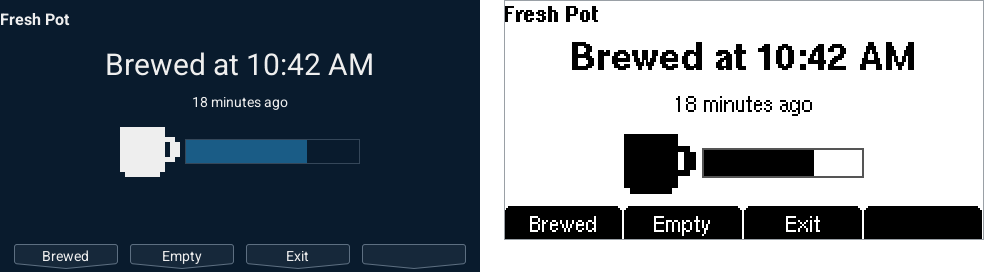

# App SDK

The App SDK is the Rust crate `dphone-app-sdk`, with which developers write apps for phones that run Open DPhone.

<figure markdown="span">
  { width="656" }
  <figcaption>Fresh Pot, the app that the tutorial builds, on a D60 and on a D40.</figcaption>
</figure>

## What an app is

An app is one file: a WebAssembly component, built from a Rust crate that depends on the crate `dphone-app-sdk`.  The phone's web interface installs the file, and the phone then lists the app in the Applications menu beside the built-in apps, which are written with the same SDK.

The phone calls an app once when the app starts, and then once for every event: a key, a softkey, a timer, a reply from the PBX.  The app answers by calling the phone to build a screen from widgets, set softkeys, start timers, store data, or send requests.  No call blocks: a request that takes time returns at once, and the result arrives later as another event.

Three properties of the phone shape every app:

- **One file runs on every model.**  The D60, D62, and D65 have a color display of 480 by 272 pixels; the D70 has a gray display of 320 by 160 pixels; and the D40, D45, and D50 have a gray display of 240 by 120 pixels.  An app asks the phone for the sizes and colors of the display and lays out the screen to match.
- **The phone confines each app.**  An app has a memory limit and a time limit for each event, and the phone stops an app that goes over either limit or that panics.  Calls and the other apps carry on.
- **An app declares no permissions.**  The phone gives an app the interfaces that the app's code calls, and no others.

## What an app can use

Each interface of the phone is a module of `dphone-app-sdk`, and each has a page in the [reference](reference/index.md).

| For | Interfaces |
| --- | --- |
| The display and the keys | [`ui`](reference/ui.md) (widgets, softkeys, keys), [`canvas`](reference/canvas.md) (free drawing), [`input`](reference/input.md) (every key and the hookswitch), [`lamps`](reference/lamps.md) |
| Time and data | [`timers`](reference/timers.md), [`storage`](reference/storage.md) (data on the phone), [`pbx-storage`](reference/pbx-storage.md) (data on the PBX, shared by every phone), [`config`](reference/config.md), [`l10n`](reference/l10n.md) |
| Telephony | [`calls`](reference/calls.md), [`presence`](reference/presence.md), [`pbx`](reference/pbx.md), [`events`](reference/events.md), [`hotdesk`](reference/hotdesk.md) |
| The network and sound | [`http`](reference/http.md), [`audio`](reference/audio.md) |
| The phone | [`runtime`](reference/runtime.md) (logging, exiting), [`alarms`](reference/alarms.md), [`diagnostics`](reference/diagnostics.md) |

## What a developer needs

- **Rust 1.88 or later**, installed with `rustup`, with the target `wasm32-unknown-unknown`, and the command `wasm-tools`.  The tutorial's first step installs both.
- **The crate `dphone-app-sdk`.**  The crate's version is the version of the firmware whose interface the crate describes, so an app for firmware 3 depends on `dphone-app-sdk = "3"` from crates.io.  An app for a phone that runs firmware built from source depends on the crate in a clone of the repository; the tutorial's first step shows [both forms](tutorial/first-app.md#create-the-crate).
- **A phone that runs Open DPhone**, and the password of that phone's web interface.  The web interface installs an app, shows the phone's log, and mirrors the phone's display.
- **A PBX with [Open DPMA](../open-dpma/index.md)**, only for an app that keeps data on the PBX.

Knowledge of WebAssembly is not needed: the SDK presents the interface as Rust functions and one trait.

## Where to go

- [Tutorial](tutorial/index.md): for a developer who has never written an app for these phones.  Five steps lead from an empty directory to an app that runs on a phone, draws on the display, and shares data between phones.
- [Reference](reference/index.md): for a developer who is writing an app.  Every function, every event, the manifest, and the limits.
- [The built-in apps](https://github.com/jackrosenthal/open-dphone/tree/main/apps): the source of the twelve apps in the firmware, as complete examples.  Hot Desking and Parking are the shortest.
