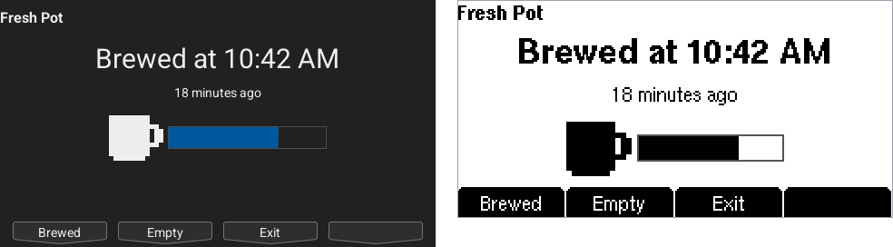

# Drawing on a canvas

Text tells the age of the pot to someone who reads the screen.  This step adds a picture for someone who only glances at the phone: a mug, and a bar that starts full and empties over an hour while the coffee goes stale.

<figure markdown="span">
  { width="656" }
  <figcaption>The app at the end of this step, 18 minutes after Brewed, on a D60 and on a D40.  One app file drew both.</figcaption>
</figure>

## What a canvas is

The widgets of [`ui`](../reference/ui.md) show text, lists, inputs, and pictures from PNG files.  For anything else, the interface [`canvas`](../reference/canvas.md) provides a widget that the app draws.  The app hands the phone a list of drawing operations, and the phone paints from the list whenever the display needs painting.  There are three operations:

| Operation | Draws |
| --- | --- |
| `Op::Fill` | A rectangle in one color. |
| `Op::Bitmap` | A picture in one color, given as one bit for each pixel, and enlarged by a whole factor. |
| `Op::Text` | One line of text in a font of the phone. |

Each call of [`canvas::draw`](../reference/canvas.md#draw) replaces the whole list, so the phone never shows half of a new picture.  Fresh Pot uses `Fill` and `Bitmap`.

Import the module and the types:

```rust
use dphone_app_sdk::canvas::{self, Bitmap, Op, Role};
```

## The mug's bits

A bitmap is rows of bits, each row padded to whole bytes, with the leftmost pixel in the highest bit.  The mug is 12 pixels wide, so each row takes two bytes, and written in binary the constant shows the picture.  Add the mug, and the number of minutes that a pot stays fresh, below the other constants:

```rust
/// After this many minutes, a pot is stale.
const FRESH_MINUTES: u64 = 60;

/// A mug, 12 pixels wide and 10 pixels high.  Each row is two bytes, and
/// the leftmost pixel of a row is the highest bit of the row's first byte.
#[rustfmt::skip]
const MUG: [u8; 20] = [
    0b1111_1111, 0b1000_0000,
    0b1111_1111, 0b1000_0000,
    0b1111_1111, 0b1110_0000,
    0b1111_1111, 0b1011_0000,
    0b1111_1111, 0b1011_0000,
    0b1111_1111, 0b1011_0000,
    0b1111_1111, 0b1110_0000,
    0b1111_1111, 0b1000_0000,
    0b1111_1111, 0b1000_0000,
    0b0111_1111, 0b0000_0000,
];
```

`#[rustfmt::skip]` keeps `cargo fmt` from joining the rows.

## Place the canvas

A canvas is created with bounds inside the window, as any widget is.  The app keeps the handle, and also the size, which the drawing needs.  Add three fields to `FreshPot`:

```rust
/// The canvas under the two lines, and the size of the canvas.
gauge: Widget,
gauge_width: u16,
gauge_height: u16,
```

In `start`, after the two text widgets, create the canvas under the second line, again in units of the phone's line height:

```rust
// The canvas: half as wide as the window, in the middle, and two
// lines high.
self.gauge_width = area.width / 2;
self.gauge_height = 2 * line;
let bounds = Rect::new(
    (area.width / 4) as i16,
    area.y + (3 * line + line / 2) as i16,
    self.gauge_width,
    self.gauge_height,
);
self.gauge = canvas::create(ROOT, bounds);
```

## Draw

Add the function that builds the list of operations to `impl FreshPot`:

```rust
/// The drawing on the canvas: a mug, and a bar that empties while the
/// pot goes stale.  Without a pot, the canvas shows nothing.
fn gauge_ops(&self) -> Vec<Op> {
    let Some(at) = self.brewed else {
        return Vec::new();
    };
    let minutes = timers::wall_time().saturating_sub(at) / 60;
    let fresh = FRESH_MINUTES.saturating_sub(minutes);

    // The mug fills the height of the canvas.
    let scale = (self.gauge_height / 10).clamp(1, 8);
    let mug_width = 12 * scale;
    let mug = Bitmap {
        x: 0,
        y: 0,
        width: 12,
        height: 10,
        scale: scale as u8,
        color: canvas::theme_color(Role::Foreground),
        bits: MUG.to_vec(),
    };

    // The bar takes the rest of the width: a frame one pixel wide, and
    // inside the frame, the part of the hour that is left.
    let x = (mug_width + scale) as i16;
    let y = (self.gauge_height / 4) as i16;
    let width = self.gauge_width - mug_width - scale;
    let height = self.gauge_height / 2;
    let filled = ((width - 2) as u64 * fresh / FRESH_MINUTES) as u16;
    let right = x + width as i16 - 1;
    let bottom = y + height as i16 - 1;
    let border = canvas::theme_color(Role::Border);
    vec![
        Op::Bitmap(mug),
        Op::Fill((Rect::new(x, y, width, 1), border)),
        Op::Fill((Rect::new(x, bottom, width, 1), border)),
        Op::Fill((Rect::new(x, y, 1, height), border)),
        Op::Fill((Rect::new(right, y, 1, height), border)),
        Op::Fill((
            Rect::new(x + 1, y + 1, filled, height - 2),
            canvas::theme_color(Role::Highlight),
        )),
    ]
}
```

Coordinates are relative to the top-left corner of the canvas, and the phone draws nothing outside the canvas.  Three choices make one drawing fit every display:

- **The size follows the canvas.**  The mug's `scale` enlarges each bit to a square, so the 10 rows fill the height of the canvas: 5 pixels to a bit on a color display, 3 on the smallest gray display.  The bar takes the rest of the width.
- **The colors come from the phone's skin.**  [`canvas::theme_color`](../reference/canvas.md#theme_color) returns the color that the phone uses for a purpose: `Role::Foreground` for text, `Role::Border` for lines, `Role::Highlight` for a selection.  The drawing therefore matches the screens around the app on a color display, and on a gray display, where the skin has four levels of gray.
- **The drawing paints only what differs from the window.**  The frame is four rectangles one pixel thick, and the only paint inside the frame is the filled part, so the window's background shows through the rest.  Where operations overlap, a later operation paints over an earlier one.

Finally, draw whenever the state is shown.  At the end of `show`, add:

```rust
if let Err(e) = canvas::draw(self.gauge, &self.gauge_ops()) {
    log_warn(&format!("the gauge was not drawn: {e}"));
}
```

`show` already runs after every softkey and at every tick of the 30-second timer, so the bar empties without further code.  `canvas::draw` refuses a list that goes over [the limits of a canvas](../reference/limits.md#ui-and-canvas), e.g., more than 512 operations, and the canvas then keeps the previous picture.

## Build, install, and try

Build and install as before:

```sh
cargo build --release --target wasm32-unknown-unknown
wasm-tools component new \
    target/wasm32-unknown-unknown/release/freshpot.wasm -o freshpot.wasm
```

Open the app.  The pot recorded in the previous step is still there, because installing a newer build keeps the app's store, and the bar shows how much of the pot's hour is left.

One limitation remains: the pot is known only to the phone on which someone pressed Brewed.  The last step, [Data shared by every phone](shared-data.md), tells the whole office.

??? example "The whole `src/lib.rs` after this step"

    ```rust
    use dphone_app_sdk::canvas::{self, Bitmap, Op, Role};
    use dphone_app_sdk::prelude::*;
    use dphone_app_sdk::{Align, Font, log_info, log_warn, read_string};

    const SK_BREWED: u32 = 1;
    const SK_EMPTY: u32 = 2;
    const SK_EXIT: u32 = 3;

    /// How often the screen is brought up to date, in milliseconds.
    const REFRESH_MS: u32 = 30_000;

    /// The key of the phone's store that holds when the pot was brewed.
    const KEY: &str = "brewed";

    /// After this many minutes, a pot is stale.
    const FRESH_MINUTES: u64 = 60;

    /// A mug, 12 pixels wide and 10 pixels high.  Each row is two bytes, and
    /// the leftmost pixel of a row is the highest bit of the row's first byte.
    #[rustfmt::skip]
    const MUG: [u8; 20] = [
        0b1111_1111, 0b1000_0000,
        0b1111_1111, 0b1000_0000,
        0b1111_1111, 0b1110_0000,
        0b1111_1111, 0b1011_0000,
        0b1111_1111, 0b1011_0000,
        0b1111_1111, 0b1011_0000,
        0b1111_1111, 0b1110_0000,
        0b1111_1111, 0b1000_0000,
        0b1111_1111, 0b1000_0000,
        0b0111_1111, 0b0000_0000,
    ];

    #[derive(Default)]
    struct FreshPot {
        /// When the pot was brewed, in seconds since the Unix epoch.
        brewed: Option<u64>,
        /// The line that says when the pot was brewed.
        status: Widget,
        /// The line that says how long ago.
        age: Widget,
        /// The canvas under the two lines, and the size of the canvas.
        gauge: Widget,
        gauge_width: u16,
        gauge_height: u16,
    }

    impl FreshPot {
        /// Reads when the pot was brewed from the phone's store.
        fn load(&mut self) {
            self.brewed = read_string(KEY).and_then(|text| text.parse().ok());
        }

        /// Writes when the pot was brewed to the phone's store.
        fn save(&self) {
            let result = match self.brewed {
                Some(at) => storage::set(KEY, at.to_string().as_bytes()),
                None => storage::remove(KEY),
            };
            if let Err(e) = result {
                log_warn(&format!("the time was not stored: {e:?}"));
            }
        }

        /// Shows the state on the screen.
        fn show(&self) {
            match self.brewed {
                Some(at) => {
                    let minutes = timers::wall_time().saturating_sub(at) / 60;
                    ui::set_text(
                        self.status,
                        &format!("Brewed at {}", l10n::format_time(at, 0)),
                    );
                    ui::set_text(self.age, &age_text(minutes));
                }
                None => {
                    ui::set_text(self.status, "No pot");
                    ui::set_text(self.age, "Press Brewed after making coffee.");
                }
            }
            if let Err(e) = canvas::draw(self.gauge, &self.gauge_ops()) {
                log_warn(&format!("the gauge was not drawn: {e}"));
            }
        }

        /// The drawing on the canvas: a mug, and a bar that empties while the
        /// pot goes stale.  Without a pot, the canvas shows nothing.
        fn gauge_ops(&self) -> Vec<Op> {
            let Some(at) = self.brewed else {
                return Vec::new();
            };
            let minutes = timers::wall_time().saturating_sub(at) / 60;
            let fresh = FRESH_MINUTES.saturating_sub(minutes);

            // The mug fills the height of the canvas.
            let scale = (self.gauge_height / 10).clamp(1, 8);
            let mug_width = 12 * scale;
            let mug = Bitmap {
                x: 0,
                y: 0,
                width: 12,
                height: 10,
                scale: scale as u8,
                color: canvas::theme_color(Role::Foreground),
                bits: MUG.to_vec(),
            };

            // The bar takes the rest of the width: a frame one pixel wide, and
            // inside the frame, the part of the hour that is left.
            let x = (mug_width + scale) as i16;
            let y = (self.gauge_height / 4) as i16;
            let width = self.gauge_width - mug_width - scale;
            let height = self.gauge_height / 2;
            let filled = ((width - 2) as u64 * fresh / FRESH_MINUTES) as u16;
            let right = x + width as i16 - 1;
            let bottom = y + height as i16 - 1;
            let border = canvas::theme_color(Role::Border);
            vec![
                Op::Bitmap(mug),
                Op::Fill((Rect::new(x, y, width, 1), border)),
                Op::Fill((Rect::new(x, bottom, width, 1), border)),
                Op::Fill((Rect::new(x, y, 1, height), border)),
                Op::Fill((Rect::new(right, y, 1, height), border)),
                Op::Fill((
                    Rect::new(x + 1, y + 1, filled, height - 2),
                    canvas::theme_color(Role::Highlight),
                )),
            ]
        }
    }

    fn age_text(minutes: u64) -> String {
        match minutes {
            0 => "Just now".to_string(),
            1 => "1 minute ago".to_string(),
            m if m < 60 => format!("{m} minutes ago"),
            m => format!("{} h {} min ago", m / 60, m % 60),
        }
    }

    impl App for FreshPot {
        fn start(&mut self) {
            let area = screen("Fresh Pot");
            let line = ui::get_metrics().line_height;

            self.status = ui::create(
                WidgetKind::Text,
                ROOT,
                Rect::new(0, area.y, area.width, 2 * line),
            );
            ui::set_font(self.status, Font::Large);
            ui::set_align(self.status, Align::Center);

            self.age = ui::create(
                WidgetKind::Text,
                ROOT,
                Rect::new(0, area.y + 2 * line as i16, area.width, line),
            );
            ui::set_align(self.age, Align::Center);

            // The canvas: half as wide as the window, in the middle, and two
            // lines high.
            self.gauge_width = area.width / 2;
            self.gauge_height = 2 * line;
            let bounds = Rect::new(
                (area.width / 4) as i16,
                area.y + (3 * line + line / 2) as i16,
                self.gauge_width,
                self.gauge_height,
            );
            self.gauge = canvas::create(ROOT, bounds);

            ui::set_softkeys(
                ROOT,
                &[
                    Softkey::new(SK_BREWED, "Brewed"),
                    Softkey::new(SK_EMPTY, "Empty"),
                    Softkey::new(SK_EXIT, "Exit"),
                ],
            );
            let _ = timers::set(REFRESH_MS, true);
            self.load();
            self.show();
        }

        fn handle(&mut self, event: Event) {
            match event {
                Event::Softkey(SK_BREWED) => {
                    self.brewed = Some(timers::wall_time());
                    self.save();
                    log_info("a pot was brewed");
                }
                Event::Softkey(SK_EMPTY) => {
                    self.brewed = None;
                    self.save();
                }
                Event::Softkey(SK_EXIT) => return runtime::exit(),
                Event::Key(key) if key == "cancel" => return runtime::exit(),
                Event::Timer(_) => {}
                _ => return,
            }
            self.show();
        }
    }

    dphone_app_sdk::export_app! {
        app: FreshPot,
        name: "freshpot",
        display_name: "Fresh Pot",
        description: "When the office coffee was brewed",
    }
    ```
