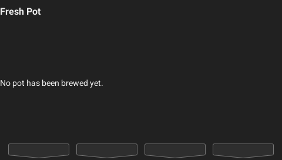

# Your first app

## Toolchain

Install the WebAssembly target, and `wasm-tools`, which turns the module that `cargo` builds into a component:

```sh
rustup target add wasm32-unknown-unknown
cargo install wasm-tools
```

## Project setup

```sh
cargo new --lib freshpot
cd freshpot
```

Replace `Cargo.toml` with:

```toml
[package]
name = "freshpot"
version = "0.1.0"
edition = "2024"

[lib]
crate-type = ["cdylib"]

[dependencies]
dphone-app-sdk = "3"

[profile.release]
opt-level = "s"
lto = "fat"
codegen-units = 1
panic = "abort"
strip = true
```

- `crate-type = ["cdylib"]` makes `cargo` build a WebAssembly module.
- `dphone-app-sdk = "3"` is the SDK for firmware 3.  The SDK version always matches the firmware version.

!!! note "Firmware built from source"

    Use the SDK from the same source.  Clone the repository next to `freshpot`:

    ```sh
    git clone https://github.com/jackrosenthal/open-dphone
    ```

    In `Cargo.toml`, replace `dphone-app-sdk = "3"` with:

    ```toml
    dphone-app-sdk = { path = "../open-dphone/crates/dphone-app-sdk" }
    ```

## App code

Replace `src/lib.rs` with:

```rust
use dphone_app_sdk::log_info;
use dphone_app_sdk::prelude::*;

#[derive(Default)]
struct FreshPot;

impl App for FreshPot {
    fn start(&mut self) {
        let area = screen("Fresh Pot");
        let text = ui::create(WidgetKind::Text, ROOT, area);
        ui::set_text(text, "No pot has been brewed yet.");
        log_info("the first screen is built");
    }

    fn handle(&mut self, event: Event) {
        match event {
            Event::Key(key) if key == "cancel" => runtime::exit(),
            _ => {}
        }
    }
}

dphone_app_sdk::export_app! {
    app: FreshPot,
    name: "freshpot",
    display_name: "Fresh Pot",
    description: "When the office coffee was brewed",
}
```

- `FreshPot` holds the app's state.  At startup, the phone creates the value with `Default::default()`.
- The phone calls `start` once, then `handle` for each event.
- [`screen`](../reference/helpers.md#screen) clears the window, draws a title, claims the cancel key (✕), and returns the rectangle below the title.  [`ui::create`](../reference/ui.md#create) makes a `Text` widget in that rectangle, a child of the window (`ROOT`).
- A cancel key press arrives as `Event::Key("cancel")`.  [`runtime::exit`](../reference/runtime.md#exit) stops the app and removes the window.
- `export_app!` registers the type and embeds the manifest in the app file.  Installing an app replaces the installed app with the same `name`, and the phone rejects the `name` of a built-in app.  The Applications menu shows `display_name`, and the web interface shows `description`.  The [manifest reference](../reference/manifest.md) lists the other fields.

## Build

In the crate directory:

```sh
cargo build --release --target wasm32-unknown-unknown
wasm-tools component new \
    target/wasm32-unknown-unknown/release/freshpot.wasm -o freshpot.wasm
```

`freshpot.wasm` is the whole app, including the manifest and embedded data.

## Installation

1. Browse to the phone's IP address and sign in.
2. On the **Apps** page, click **Install App** and choose `freshpot.wasm`.
3. Wait a few seconds while the phone compiles the app.

A newer build installs the same way.  The phone replaces the app and stops the running copy; open the app again.

## First run

Open Fresh Pot from the Applications menu (**Applications** in the main menu, or the **Apps** softkey on the idle screen), or click **Open** on the **Apps** page.  The **Screen** page mirrors the display and has the phone's keys.

<figure markdown="span">
  { width="480" }
</figure>

Press the cancel key to exit.

## Logs

On the **Logs** page, type `freshpot` in **Filter**.  The page shows the app's `log_info` line and the phone's lines about the app:

```text
INFO  dphone_apps::manager app freshpot: installed
INFO  app freshpot: the first screen is built
INFO  dphone_apps::manager app freshpot: started
INFO  dphone_apps::manager app freshpot: stopped
```

After a panic, the phone stops the app, and the log shows the panic message with file and line:

```text
ERROR app freshpot: panicked at src/lib.rs:81: the pot is empty
```

A second error line, from the phone, starts with `app freshpot: stopped after a fault` and includes a WebAssembly backtrace.
