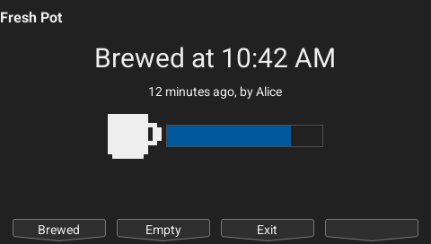

# Tutorial

This tutorial builds Fresh Pot, an app for the office coffee pot.  Whoever makes coffee presses a softkey on the nearest phone, and every phone in the office then shows when the pot was brewed, by whom, and how fresh the coffee still is.  The tutorial starts from an empty directory and ends with that app running on a phone.

<figure markdown="span">
  { width="480" }
  <figcaption>Fresh Pot on Bob's phone, twelve minutes after Alice pressed Brewed on another phone.</figcaption>
</figure>

## Before starting

The tutorial assumes a reader who knows some Rust (structs, enums, traits, and `match`) and has never written an app for these phones.  Knowledge of WebAssembly is not needed.

The reader needs:

- A computer with Rust 1.88 or later, installed with [`rustup`](https://rustup.rs/).
- A phone that runs Open DPhone, on the same network as the computer, and the password of the phone's web interface.
- For the last step only, a PBX that runs [Open DPMA](../../open-dpma/index.md).  Without one, the app of the last step still works, on one phone.

## The steps

Each step adds one ability to the app, and each ends with an app that builds, installs, and runs.

| Step | What the app gains | What the step teaches |
| --- | --- | --- |
| 1. [A first app](first-app.md) | A screen with one line of text. | The tools, the crate, the manifest, building the app file, installing the file from the web interface, and reading the log. |
| 2. [Softkeys, keys, and state](softkeys-and-state.md) | The softkeys Brewed, Empty, and Exit, and the age of the pot. | Laying out widgets for every display, softkeys, keys, timers, and handling events. |
| 3. [Keeping data](keeping-data.md) | The pot's time outlasts the app. | When the phone ends an app, and the store that the phone keeps for each app. |
| 4. [Drawing on a canvas](drawing.md) | A mug, and a bar that empties while the coffee goes stale. | Free drawing with the colors of the phone's skin. |
| 5. [Data shared by every phone](shared-data.md) | Every phone of the office shows the same pot, and who brewed the pot. | The app's store on the PBX, and requests whose results arrive as events. |

Each page prints every change to the source, and ends with the whole `src/lib.rs` as the file stands after the step.
