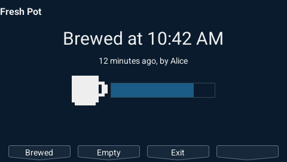

# Shared data

A coffee pot serves the whole office, not one desk.  This last chapter moves the brew time to the PBX, so that pressing **Brewed** on any phone updates every phone, along with the name of the person who pressed the key.

<figure markdown="span">
  { width="480" }
  <figcaption>Bob's phone, twelve minutes after Alice pressed Brewed on another phone.</figcaption>
</figure>

## PBX storage

The [`pbx-storage`](../reference/pbx-storage.md) interface (the Rust module `pbx_storage`) is a second key-value store, hosted by the PBX.  The store requires a PBX running [Open DPMA](../../open-dpma/index.md), and needs no configuration in the app or on the phone.  An app has two sets of keys there:

- `PbxScope::Shared`: one set shared by every phone on the PBX that runs the app.  Fresh Pot keeps the pot here.
- `PbxScope::User`: one set per user, the same on every phone that the user signs in to.  A game might keep a player's progress here.

PBX storage differs from the phone's store in two ways:

- **Requests are asynchronous.**  The PBX is across the network, and no call from an app may block.  `get`, `set`, and `remove` immediately return a request ID, and the result arrives later as an `Event::PbxStorage` with the same ID.
- **The PBX records the author of every entry.**  An entry comes back with the value and the name of the user who wrote the value.  The PBX fills in the name from the user that the writing phone is provisioned for, so Fresh Pot can show who brewed the pot without ever asking for a name.

## Design

The phone's store stays, as a cache between answers from the PBX:

1. On startup, the app shows what the phone's store holds and queries the PBX.
2. Every answer from the PBX replaces the app's state and is saved to the phone's store.
3. **Brewed** and **Empty** update the state immediately, save, and send the change to the PBX.
4. When another phone changes the pot, the PBX notifies this phone, and the app queries the PBX again.

On a phone whose PBX has no store, every request ends in `Unreachable`, and the app behaves as in the previous chapter.

## New state

Both stores use the same key name.  Update the comment on the constant to say so:

```rust
/// The storage key for the time the pot was brewed, used both on the
/// phone and on the PBX.
const KEY: &str = "brewed";
```

Add two fields to `FreshPot`, one for the name and one for the ID of the request that the app is waiting on:

```rust
/// Who brewed the pot, as reported by the PBX.
by: String,
/// The ID of the pending PBX request.
asked: u32,
```

## Requests and responses

Add two functions to `impl FreshPot`:

```rust
/// Requests the brew time from the PBX.
fn ask(&mut self) {
    self.asked = pbx_storage::get(PbxScope::Shared, KEY);
}

/// Applies the PBX's answer: the key's entry, or `None` if the key
/// isn't set.
fn take(&mut self, entry: Option<PbxEntry>) {
    self.brewed = entry
        .as_ref()
        .and_then(|e| str::from_utf8(&e.value).ok()?.parse().ok());
    self.by = entry.map(|e| e.author_name).unwrap_or_default();
    self.save();
}
```

`ask` sends a `get` and remembers the request ID.  `take` receives a [`PbxEntry`](../reference/pbx-storage.md#requests-and-outcomes), or `None` if the key isn't set on the PBX.  The entry's `value` holds the bytes that a phone wrote (here, the time as text), and `author_name` is the name that the PBX recorded for the writer.

In `show`, add the name to the second line.  Replace the line that sets the text of `self.age` with:

```rust
let mut age = age_text(minutes);
if !self.by.is_empty() {
    age = format!("{age}, by {}", self.by);
}
ui::set_text(self.age, &age);
```

## Startup

At the end of `start`, after rendering what the phone's store holds, subscribe to change notifications and query the PBX:

```rust
self.load();
self.show();

pbx_storage::watch(true);
self.ask();
```

After [`pbx_storage::watch(true)`](../reference/pbx-storage.md#watch), the app receives an `Event::PbxStorageChanged` whenever another phone sets or removes one of the app's shared keys, for as long as the app runs.

## Event handling

Replace `handle` with:

```rust
fn handle(&mut self, event: Event) {
    match event {
        Event::Softkey(SK_BREWED) => {
            let now = timers::wall_time();
            self.brewed = Some(now);
            self.by = pbx_storage::user()
                .map(|user| user.name)
                .unwrap_or_default();
            self.save();
            self.asked =
                pbx_storage::set(PbxScope::Shared, KEY, now.to_string().as_bytes(), None);
            log_info("a pot was brewed");
        }
        Event::Softkey(SK_EMPTY) => {
            self.brewed = None;
            self.save();
            self.asked = pbx_storage::remove(PbxScope::Shared, KEY, None);
        }
        Event::PbxStorage((id, outcome)) if id == self.asked => match outcome {
            PbxStorageOutcome::Entry(entry) => self.take(entry),
            PbxStorageOutcome::Stored(entry) => self.take(Some(entry)),
            PbxStorageOutcome::Removed => self.take(None),
            // Keep showing what the phone's store holds.
            PbxStorageOutcome::Unreachable(why) => log_info(&format!("not shared: {why}")),
            other => log_warn(&format!("unexpected answer from the PBX: {other:?}")),
        },
        // Another phone changed the key, or the PBX is reachable again.
        Event::PbxStorageChanged(_) | Event::PbxStorageOnline => return self.ask(),
        Event::Softkey(SK_EXIT) => return runtime::exit(),
        Event::Key(key) if key == "cancel" => return runtime::exit(),
        // On a timer tick, or when the window returns to the screen
        // (possibly with a new theme's colors), fall through and redraw.
        Event::Timer(_) | Event::Foreground => {}
        _ => return,
    }
    self.show();
}
```

The softkeys now also write to the PBX:

- **Brewed** sets the key to the current time.  [`pbx_storage::user`](../reference/pbx-storage.md#user) returns the phone's user as known to the PBX, so the name appears immediately, before the PBX answers.  The last argument to `set`, `None`, makes the write unconditional.  For a pot of coffee, the latest press wins.  An app where two phones must not overwrite each other, such as a shared list, passes the version of the entry that the app last read instead; see [Concurrent writes](../reference/pbx-storage.md#concurrent-writes).
- **Empty** removes the key.

Three new arms handle what comes back:

- **`Event::PbxStorage`** is the answer to a request.  The guard `id == self.asked` ignores answers to all but the latest request.  `Entry` answers a `get`, `Stored` answers a `set` with the entry as now stored on the PBX, and `Removed` answers a `remove`.  All three end up in `take`.  `Unreachable` means that the request never reached the PBX or that the PBX didn't answer; the app logs the reason and keeps showing what the phone's store holds.  Of the remaining outcomes, only `Refused` can follow these requests (the PBX refuses a value larger than 4096 bytes, for example), and the app logs a warning.
- **`Event::PbxStorageChanged`** means that another phone wrote the key.  The event carries no value, so the app queries the PBX.
- **`Event::PbxStorageOnline`** means that the store has become reachable, for the first time or again.  Anything the app read earlier may be stale, so the app queries the PBX.

The last two arms return without calling `show`, because nothing changes until the answer arrives.

!!! note "Pressing Brewed while the PBX is unreachable"

    The phone doesn't queue failed writes for later.  In Fresh Pot, pressing **Brewed** while the PBX is unreachable therefore shows up only on that phone, and the PBX's value takes over again once the PBX is back.  An app that can't afford to lose a write keeps the write in `storage` and sends the write again on `Event::PbxStorageOnline`; see [Offline behavior](../reference/pbx-storage.md#offline-behavior).

## Build and run

Build the app as before, and install the app file on two phones on the same PBX:

```sh
cargo build --release --target wasm32-unknown-unknown
wasm-tools component new \
    target/wasm32-unknown-unknown/release/freshpot.wasm -o freshpot.wasm
```

Open the app on both phones and press **Brewed** on one.  A moment later, the other phone shows the same time, with the name of the first phone's user.  Press **Empty** on either phone, and both go back to "No pot".

If you have only one phone, the second line shows the name of that phone's user after you press **Brewed**.  If the phone has no PBX store to reach, the **Logs** page shows `not shared:` followed by the reason.

## Next steps

Fresh Pot is complete: about 250 lines of Rust in one file, running on every model.  Some features that the tutorial didn't cover:

- **An icon.**  The manifest fields [`icon` and `icon_for`](../reference/manifest.md#fields) give the app an icon in the Applications menu, from PNG files embedded in the crate.
- **Lists and text input.**  The [`TextList` and `Input` widgets](../reference/ui.md#widget-kinds) handle selection and typing.
- **Running in the background.**  A [`Background` app](../reference/index.md#app-lifecycle) starts with the phone and keeps running off screen.

??? example "Complete `src/lib.rs` for this chapter"

    ```rust
    use dphone_app_sdk::canvas::{self, Bitmap, Op, Role};
    use dphone_app_sdk::prelude::*;
    use dphone_app_sdk::{Align, Font, log_info, log_warn, read_string};

    const SK_BREWED: u32 = 1;
    const SK_EMPTY: u32 = 2;
    const SK_EXIT: u32 = 3;

    /// How often the screen refreshes, in milliseconds.
    const REFRESH_MS: u32 = 30_000;

    /// The storage key for the time the pot was brewed, used both on the
    /// phone and on the PBX.
    const KEY: &str = "brewed";

    /// A pot is stale after this many minutes.
    const FRESH_MINUTES: u64 = 60;

    /// A mug, 12 pixels wide and 10 pixels tall.  Each row is two bytes, and
    /// the leftmost pixel is the high bit of the first byte.
    #[rustfmt::skip]
    const MUG: [u8; 20] = [
        0b1111_1111, 0b1000_0000,
        0b1111_1111, 0b1000_0000,
        0b1111_1111, 0b1110_0000,
        0b1111_1111, 0b1011_0000,
        0b1111_1111, 0b1011_0000,
        0b1111_1111, 0b1011_0000,
        0b1111_1111, 0b1110_0000,
        0b1111_1111, 0b1000_0000,
        0b1111_1111, 0b1000_0000,
        0b0111_1111, 0b0000_0000,
    ];

    #[derive(Default)]
    struct FreshPot {
        /// When the pot was brewed, in seconds since the Unix epoch.
        brewed: Option<u64>,
        /// Who brewed the pot, as reported by the PBX.
        by: String,
        /// The ID of the pending PBX request.
        asked: u32,
        /// The line that shows when the pot was brewed.
        status: Widget,
        /// The line that shows how long ago that was.
        age: Widget,
        /// The canvas below the two lines of text, and the canvas dimensions.
        gauge: Widget,
        gauge_width: u16,
        gauge_height: u16,
    }

    impl FreshPot {
        /// Loads the brew time from the phone's store.
        fn load(&mut self) {
            self.brewed = read_string(KEY).and_then(|text| text.parse().ok());
        }

        /// Saves the brew time to the phone's store.
        fn save(&self) {
            let result = match self.brewed {
                Some(at) => storage::set(KEY, at.to_string().as_bytes()),
                None => storage::remove(KEY),
            };
            if let Err(e) = result {
                log_warn(&format!("couldn't store the brew time: {e:?}"));
            }
        }

        /// Requests the brew time from the PBX.
        fn ask(&mut self) {
            self.asked = pbx_storage::get(PbxScope::Shared, KEY);
        }

        /// Applies the PBX's answer: the key's entry, or `None` if the key
        /// isn't set.
        fn take(&mut self, entry: Option<PbxEntry>) {
            self.brewed = entry
                .as_ref()
                .and_then(|e| str::from_utf8(&e.value).ok()?.parse().ok());
            self.by = entry.map(|e| e.author_name).unwrap_or_default();
            self.save();
        }

        /// Renders the state to the screen.
        fn show(&self) {
            match self.brewed {
                Some(at) => {
                    let minutes = timers::wall_time().saturating_sub(at) / 60;
                    ui::set_text(
                        self.status,
                        &format!("Brewed at {}", l10n::format_time(at, TimeStyle::Time)),
                    );
                    let mut age = age_text(minutes);
                    if !self.by.is_empty() {
                        age = format!("{age}, by {}", self.by);
                    }
                    ui::set_text(self.age, &age);
                }
                None => {
                    ui::set_text(self.status, "No pot");
                    ui::set_text(self.age, "Press Brewed after making coffee.");
                }
            }
            if let Err(e) = canvas::draw(self.gauge, &self.gauge_ops()) {
                log_warn(&format!("couldn't draw the gauge: {e}"));
            }
        }

        /// The drawing operations for the canvas: a mug, and a bar that empties
        /// as the pot goes stale.  With no pot, the canvas is empty.
        fn gauge_ops(&self) -> Vec<Op> {
            let Some(at) = self.brewed else {
                return Vec::new();
            };
            let minutes = timers::wall_time().saturating_sub(at) / 60;
            let fresh = FRESH_MINUTES.saturating_sub(minutes);

            // Scale the mug to the height of the canvas.
            let scale = (self.gauge_height / 10).clamp(1, 8);
            let mug_width = 12 * scale;
            let mug = Bitmap {
                x: 0,
                y: 0,
                width: 12,
                height: 10,
                scale: scale as u8,
                color: canvas::theme_color(Role::Foreground),
                bits: MUG.to_vec(),
            };

            // The bar takes up the remaining width: a one-pixel frame, filled
            // in proportion to the time left in the hour.
            let x = (mug_width + scale) as i16;
            let y = (self.gauge_height / 4) as i16;
            let width = self.gauge_width - mug_width - scale;
            let height = self.gauge_height / 2;
            let filled = ((width - 2) as u64 * fresh / FRESH_MINUTES) as u16;
            let right = x + width as i16 - 1;
            let bottom = y + height as i16 - 1;
            let border = canvas::theme_color(Role::Border);
            vec![
                Op::Bitmap(mug),
                Op::Fill((Rect::new(x, y, width, 1), border)),
                Op::Fill((Rect::new(x, bottom, width, 1), border)),
                Op::Fill((Rect::new(x, y, 1, height), border)),
                Op::Fill((Rect::new(right, y, 1, height), border)),
                Op::Fill((
                    Rect::new(x + 1, y + 1, filled, height - 2),
                    canvas::theme_color(Role::Highlight),
                )),
            ]
        }
    }

    fn age_text(minutes: u64) -> String {
        match minutes {
            0 => "Just now".to_string(),
            1 => "1 minute ago".to_string(),
            m if m < 60 => format!("{m} minutes ago"),
            m => format!("{} h {} min ago", m / 60, m % 60),
        }
    }

    impl App for FreshPot {
        fn start(&mut self) {
            let area = screen("Fresh Pot");
            let line = ui::get_metrics().line_height;

            self.status = ui::create(
                WidgetKind::Text,
                ROOT,
                Rect::new(0, area.y, area.width, 2 * line),
            );
            ui::set_font(self.status, Font::Large);
            ui::set_align(self.status, Align::Center);

            self.age = ui::create(
                WidgetKind::Text,
                ROOT,
                Rect::new(0, area.y + 2 * line as i16, area.width, line),
            );
            ui::set_align(self.age, Align::Center);

            // The canvas is half the width of the window, centered, and two
            // lines tall.
            self.gauge_width = area.width / 2;
            self.gauge_height = 2 * line;
            let bounds = Rect::new(
                (area.width / 4) as i16,
                area.y + (3 * line + line / 2) as i16,
                self.gauge_width,
                self.gauge_height,
            );
            self.gauge = canvas::create(ROOT, bounds);

            ui::set_softkeys(
                ROOT,
                &[
                    Softkey::new(SK_BREWED, "Brewed"),
                    Softkey::new(SK_EMPTY, "Empty"),
                    Softkey::new(SK_EXIT, "Exit"),
                ],
            );
            let _ = timers::set(REFRESH_MS, true);
            self.load();
            self.show();

            pbx_storage::watch(true);
            self.ask();
        }

        fn handle(&mut self, event: Event) {
            match event {
                Event::Softkey(SK_BREWED) => {
                    let now = timers::wall_time();
                    self.brewed = Some(now);
                    self.by = pbx_storage::user()
                        .map(|user| user.name)
                        .unwrap_or_default();
                    self.save();
                    self.asked =
                        pbx_storage::set(PbxScope::Shared, KEY, now.to_string().as_bytes(), None);
                    log_info("a pot was brewed");
                }
                Event::Softkey(SK_EMPTY) => {
                    self.brewed = None;
                    self.save();
                    self.asked = pbx_storage::remove(PbxScope::Shared, KEY, None);
                }
                Event::PbxStorage((id, outcome)) if id == self.asked => match outcome {
                    PbxStorageOutcome::Entry(entry) => self.take(entry),
                    PbxStorageOutcome::Stored(entry) => self.take(Some(entry)),
                    PbxStorageOutcome::Removed => self.take(None),
                    // Keep showing what the phone's store holds.
                    PbxStorageOutcome::Unreachable(why) => log_info(&format!("not shared: {why}")),
                    other => log_warn(&format!("unexpected answer from the PBX: {other:?}")),
                },
                // Another phone changed the key, or the PBX is reachable again.
                Event::PbxStorageChanged(_) | Event::PbxStorageOnline => return self.ask(),
                Event::Softkey(SK_EXIT) => return runtime::exit(),
                Event::Key(key) if key == "cancel" => return runtime::exit(),
                // On a timer tick, or when the window returns to the screen
                // (possibly with a new theme's colors), fall through and redraw.
                Event::Timer(_) | Event::Foreground => {}
                _ => return,
            }
            self.show();
        }
    }

    dphone_app_sdk::export_app! {
        app: FreshPot,
        name: "freshpot",
        display_name: "Fresh Pot",
        description: "When the office coffee was brewed",
    }
    ```
