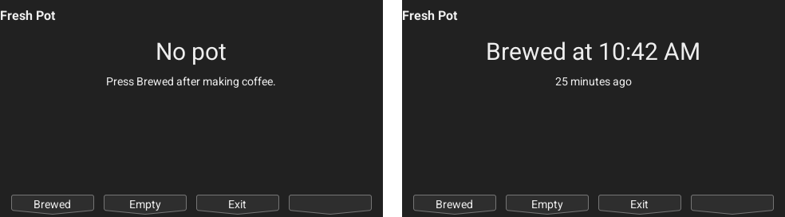

# Softkeys, keys, and state

This step makes the app useful on one phone.  The softkey **Brewed** records the time, the screen shows that time and the age of the pot, **Empty** clears both, and a timer keeps the age current.  All the changes are in `src/lib.rs`; `Cargo.toml` stays as written in [the first step](first-app.md).

<figure markdown="span">
  { width="656" }
  <figcaption>The app at the end of this step: before anyone has pressed Brewed, and 25 minutes after.</figcaption>
</figure>

## Give the app state

The app's type gets fields.  `brewed` is the app's whole knowledge of the pot, and the two `Widget` fields are handles to the two lines of text, kept so that later events can change the text:

```rust
#[derive(Default)]
struct FreshPot {
    /// When the pot was brewed, in seconds since the Unix epoch.
    brewed: Option<u64>,
    /// The line that says when the pot was brewed.
    status: Widget,
    /// The line that says how long ago.
    age: Widget,
}
```

`Default` still creates the value, so `brewed` starts as `None`.  A `Widget` is a number, and the default of 0 is the window; `start` replaces both handles before anything uses them.

## Lay out the screen for every display

The same app file runs on a color display of 480 by 272 pixels and on gray displays of 320 by 160 and 240 by 120 pixels, so the app takes every size from the phone.  `screen` returns the rectangle under the title, and [`ui::get_metrics`](../reference/ui.md#get_metrics) gives, among other sizes, the height of a line of text in the phone's normal font.

Replace `start` with:

```rust
fn start(&mut self) {
    let area = screen("Fresh Pot");
    let line = ui::get_metrics().line_height;

    self.status = ui::create(
        WidgetKind::Text,
        ROOT,
        Rect::new(0, area.y, area.width, 2 * line),
    );
    ui::set_font(self.status, Font::Large);
    ui::set_align(self.status, Align::Center);

    self.age = ui::create(
        WidgetKind::Text,
        ROOT,
        Rect::new(0, area.y + 2 * line as i16, area.width, line),
    );
    ui::set_align(self.age, Align::Center);

    ui::set_softkeys(
        ROOT,
        &[
            Softkey::new(SK_BREWED, "Brewed"),
            Softkey::new(SK_EMPTY, "Empty"),
            Softkey::new(SK_EXIT, "Exit"),
        ],
    );
    let _ = timers::set(REFRESH_MS, true);
    self.show();
}
```

The first widget is two lines high and uses `Font::Large`; the second sits under the first and is one line high.  `Align::Center` centers each text in the widget's rectangle.  `Font` and `Align` are not in the SDK's prelude, so the imports at the top of the file change to:

```rust
use dphone_app_sdk::prelude::*;
use dphone_app_sdk::{Align, Font, log_info};
```

## Softkeys

[`ui::set_softkeys`](../reference/ui.md#set_softkeys), near the end of `start`, puts labels above the keys under the display, from the left.  Each softkey carries a number that the app chooses, and a press arrives as `Event::Softkey` with that number.  Name the numbers, and the refresh period that the timer uses, at the top of the file:

```rust
const SK_BREWED: u32 = 1;
const SK_EMPTY: u32 = 2;
const SK_EXIT: u32 = 3;

/// How often the screen is brought up to date, in milliseconds.
const REFRESH_MS: u32 = 30_000;
```

A window has room for four softkeys; given more, the phone shows three and the label "More", which pages through the rest.

## Show the state

One function writes the state to the screen, and every event that changes the state ends by calling that function.  [`timers::wall_time`](../reference/timers.md#wall_time) is the current time in seconds since the Unix epoch, and [`l10n::format_time`](../reference/l10n.md) turns such a time into text in the phone's time zone and in the 12-hour or 24-hour form that the phone is set to:

```rust
impl FreshPot {
    /// Shows the state on the screen.
    fn show(&self) {
        match self.brewed {
            Some(at) => {
                let minutes = timers::wall_time().saturating_sub(at) / 60;
                ui::set_text(
                    self.status,
                    &format!("Brewed at {}", l10n::format_time(at, 0)),
                );
                ui::set_text(self.age, &age_text(minutes));
            }
            None => {
                ui::set_text(self.status, "No pot");
                ui::set_text(self.age, "Press Brewed after making coffee.");
            }
        }
    }
}

fn age_text(minutes: u64) -> String {
    match minutes {
        0 => "Just now".to_string(),
        1 => "1 minute ago".to_string(),
        m if m < 60 => format!("{m} minutes ago"),
        m => format!("{} h {} min ago", m / 60, m % 60),
    }
}
```

## Handle the events

Replace `handle` with:

```rust
fn handle(&mut self, event: Event) {
    match event {
        Event::Softkey(SK_BREWED) => {
            self.brewed = Some(timers::wall_time());
            log_info("a pot was brewed");
        }
        Event::Softkey(SK_EMPTY) => self.brewed = None,
        Event::Softkey(SK_EXIT) => return runtime::exit(),
        Event::Key(key) if key == "cancel" => return runtime::exit(),
        Event::Timer(_) => {}
        _ => return,
    }
    self.show();
}
```

Each arm is one kind of event:

- **Softkeys.**  Brewed stores the current time, and Empty clears the time.  Exit ends the app.
- **Keys.**  The cancel key arrives as `Event::Key`, because `screen` claimed the key for the window; the app treats the key as Exit.  A key arrives as an event only when the app has claimed the key with [`ui::claim_keys`](../reference/ui.md#claim_keys); the page [Events](../reference/app-events.md#key) lists the names of the keys.
- **The timer.**  [`timers::set(REFRESH_MS, true)`](../reference/timers.md#set) in `start` asked for an `Event::Timer` every 30 seconds.  What the call returns identifies the timer, for an app that has several timers or cancels one; Fresh Pot has one timer, and discards the value with `let _ =`.  The arm does nothing but fall through to `show`, which computes the age again.
- **Everything else** returns without redrawing.

The phone allows `handle` two seconds for one event and stops an app that takes longer, so an app with long work to do splits the work over timer events.

## Build, install, and try

Build the app file and install the file as in the first step:

```sh
cargo build --release --target wasm32-unknown-unknown
wasm-tools component new \
    target/wasm32-unknown-unknown/release/freshpot.wasm -o freshpot.wasm
```

Open the app and press **Brewed**: the screen shows the time and "Just now", and after a minute the second line begins to count.  Then press **Exit**, and open the app again.  The screen says "No pot": the time is gone.  The [next step](keeping-data.md) explains why, and fixes the loss.

??? example "The whole `src/lib.rs` after this step"

    ```rust
    use dphone_app_sdk::prelude::*;
    use dphone_app_sdk::{Align, Font, log_info};

    const SK_BREWED: u32 = 1;
    const SK_EMPTY: u32 = 2;
    const SK_EXIT: u32 = 3;

    /// How often the screen is brought up to date, in milliseconds.
    const REFRESH_MS: u32 = 30_000;

    #[derive(Default)]
    struct FreshPot {
        /// When the pot was brewed, in seconds since the Unix epoch.
        brewed: Option<u64>,
        /// The line that says when the pot was brewed.
        status: Widget,
        /// The line that says how long ago.
        age: Widget,
    }

    impl FreshPot {
        /// Shows the state on the screen.
        fn show(&self) {
            match self.brewed {
                Some(at) => {
                    let minutes = timers::wall_time().saturating_sub(at) / 60;
                    ui::set_text(
                        self.status,
                        &format!("Brewed at {}", l10n::format_time(at, 0)),
                    );
                    ui::set_text(self.age, &age_text(minutes));
                }
                None => {
                    ui::set_text(self.status, "No pot");
                    ui::set_text(self.age, "Press Brewed after making coffee.");
                }
            }
        }
    }

    fn age_text(minutes: u64) -> String {
        match minutes {
            0 => "Just now".to_string(),
            1 => "1 minute ago".to_string(),
            m if m < 60 => format!("{m} minutes ago"),
            m => format!("{} h {} min ago", m / 60, m % 60),
        }
    }

    impl App for FreshPot {
        fn start(&mut self) {
            let area = screen("Fresh Pot");
            let line = ui::get_metrics().line_height;

            self.status = ui::create(
                WidgetKind::Text,
                ROOT,
                Rect::new(0, area.y, area.width, 2 * line),
            );
            ui::set_font(self.status, Font::Large);
            ui::set_align(self.status, Align::Center);

            self.age = ui::create(
                WidgetKind::Text,
                ROOT,
                Rect::new(0, area.y + 2 * line as i16, area.width, line),
            );
            ui::set_align(self.age, Align::Center);

            ui::set_softkeys(
                ROOT,
                &[
                    Softkey::new(SK_BREWED, "Brewed"),
                    Softkey::new(SK_EMPTY, "Empty"),
                    Softkey::new(SK_EXIT, "Exit"),
                ],
            );
            let _ = timers::set(REFRESH_MS, true);
            self.show();
        }

        fn handle(&mut self, event: Event) {
            match event {
                Event::Softkey(SK_BREWED) => {
                    self.brewed = Some(timers::wall_time());
                    log_info("a pot was brewed");
                }
                Event::Softkey(SK_EMPTY) => self.brewed = None,
                Event::Softkey(SK_EXIT) => return runtime::exit(),
                Event::Key(key) if key == "cancel" => return runtime::exit(),
                Event::Timer(_) => {}
                _ => return,
            }
            self.show();
        }
    }

    dphone_app_sdk::export_app! {
        app: FreshPot,
        name: "freshpot",
        display_name: "Fresh Pot",
        description: "When the office coffee was brewed",
    }
    ```
