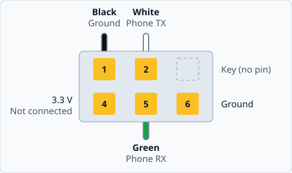

# SSH and the serial console

Open DPhone has two ways to a shell on the phone, and both are off until switched on: an SSH server on the network, and a serial console on the EHS port.  SSH is the everyday tool for pushing builds, installing images, and reading logs.  The serial console shows the kernel's messages and still works when the network or the main role does not, which makes the console the tool for kernel work and for a phone that fails to come up.

Both give a root shell.  The shell is [brush](https://github.com/reubeno/brush), a Bash-compatible shell, with the uutils versions of the common utilities, `sed`, and the [`dphone` command](dphone-command.md).

## SSH

The SSH server accepts public keys only; there is no password login.  The login name is `root`.  Two things are needed: the SSH setting switched on, and at least one public key.  Each can come from the phone's web interface or from the PBX.

### From the web interface

On the **System** page, the **SSH** card has the **Enabled** switch and the list of keys.  Paste a public key (the contents of a `.pub` file, e.g., `~/.ssh/id_ed25519.pub`) into the box, or choose the file, and select **Add Key**.  The switch takes effect at once, with no restart.

Keys added in the web interface are kept in `/nvdata/root/.ssh/authorized_keys`, the same file that the SSH server of stock firmware reads.

A phone that a DPMA server provisions serves the web interface only when the phone's section of `res_digium_phone.conf` has `web_ui_enabled=yes`.

### From the PBX

With [Open DPMA](../open-dpma/index.md) on the PBX, the phone's section of `res_digium_phone.conf` can switch SSH on and supply keys, which suits a set of development phones that are reset often:

```ini
[phone101]
type=phone
dphone_ssh_enabled=yes
dphone_ssh_authorized_key=ssh-ed25519 AAAAC3NzaC1lZDI1NTE5AAAAIAaaaaaaaaaaaaaaaaaaaaaaaaaaaaaaaaaaaaaaaaaa alice@laptop
```

Repeat `dphone_ssh_authorized_key` for more keys.  The original `res_digium_phone` does not have these options; [Options for Open DPhone](../open-dpma/open-dphone-options.md#dphone_ssh_enabled) describes each.

A provisioned key is accepted in addition to the keys added on the phone, and disappears from the phone when the PBX no longer supplies the key.

A value of the SSH setting that was set on the phone goes before `dphone_ssh_enabled`.  On a phone where the setting was never set, the PBX's value applies, and the switch in the web interface is disabled and marked as coming from DPMA.

### From a shell

From a shell that is already open, e.g., on the serial console, SSH is switched on in the file that the web interface writes the setting to, `/nvdata/dphone_settings.txtpb`, which has one field to a line.  Set the field, and have the main role read the configuration again.  When the file has no `ssh_enabled` line yet:

```sh
echo 'ssh_enabled: true' >> /nvdata/dphone_settings.txtpb
dphone config reload
```

Keep one line for each field: when the file already has the line, change the value on that line.  The field for the serial console is `serial_console: true`.

### Logging in

```sh
ssh root@192.0.2.20
```

Replace `192.0.2.20` with the phone's address.  The server also runs single commands and serves SFTP, so `scp` and `sftp` copy files to and from the phone:

```sh
ssh root@192.0.2.20 dphone version
scp root@192.0.2.20:/tmp/screen.ppm .
```

The phone creates an Ed25519 host key on first use and keeps the key in nvdata, so the host key stays the same across firmware updates.  The server accepts at most six connections at a time.

Switching SSH off closes the listening socket and leaves the sessions that are already open running, so a developer who switches SSH off from an SSH session is not cut off in the middle of a command.

## The serial console on the EHS port

The phone's serial port is the EHS port, the connector for an electronic hook switch headset adapter.  A headset adapter and a console cannot share the port, so a setting chooses between the two.  With the setting at the default, Headset, the phone writes nothing to the port: no kernel messages, no shell, and no log output.

### Switch the port to the console

On the **System** page of the web interface, set **EHS Port** to **Serial Console (115200 8N1)**.  The change takes effect at once.  From the PBX, the option in the phone's section is [`dphone_serial_console`](../open-dpma/open-dphone-options.md#dphone_serial_console):

```ini
dphone_serial_console=yes
```

While the setting is Serial Console:

- the kernel writes console messages to the port,
- the main role's log is copied to the port, and
- a root shell runs on the port, with no login prompt.

Anyone with physical access to the port then has a root shell, so return the setting to Headset on a phone that goes back into service.

The console also takes over without the setting in one case: when the main role fails, the init role gives the port to the console until a main role that works decides again.  A phone whose main role cannot start can therefore be reached with a cable alone.

### The header and the cable

Every model has the same EHS header: two rows of three positions with a pitch of 1 mm.  One position has no pin and serves as the key.  Seen when attaching the cable, with the key at the top right:

{ width="420" }

| Pin | Function | USB serial cable |
| --- | --- | --- |
| 1 | Ground | Ground wire (black) |
| 2 | Phone TX, the phone's output | The cable's receive wire (white) |
| 3 | Key, no pin | |
| 4 | 3.3 V supply from the phone | Leave unconnected |
| 5 | Phone RX, the phone's input | The cable's transmit wire (green) |
| 6 | Ground | The ground wire may go here instead of pin 1 |

Use a USB serial cable with 3.3 V logic levels.  The wire colors in the table are those of the common USB serial cables with four loose wires; check the cable's documentation, because colors vary between makers.

!!! danger "Do not connect the cable's power wire"
    Pin 4 carries the phone's 3.3 V supply.  The power wire of a USB serial cable (red, 5 V from the USB port) must stay unconnected.  Three wires are enough: ground, the phone's TX, and the phone's RX.

### The terminal

The speed is 115200 bits per second, with 8 data bits, no parity, and 1 stop bit (8N1), and no flow control.  With the cable at `/dev/ttyUSB0`, any terminal program will do, e.g.:

```sh
picocom -b 115200 /dev/ttyUSB0
```

Press ++enter++ for a prompt.

### Kernel messages from the first moment of a boot

The firmware applies the setting, so with the setting alone, the kernel's messages appear on the port only after the main role has started.  The kernel parameter `amba_pl011.console_output=1` makes the kernel write to the port from the start of the boot.

For an image started from RAM, pass the parameter with `--append` (see [Trying a build without installing](ramboot.md#start-an-image-from-ram)):

```sh
ssh root@192.0.2.20 dphone ramboot --append amba_pl011.console_output=1 - < result
```

For an image that is to be installed, add the parameter to the `bootargs` property in `kernel/files/arch/arm/boot/dts/broadcom/bcmring-digium-common.dtsi` and build the image; the boot loader's part of the kernel command line cannot be changed.

On a running phone, the same switch is the file `/sys/module/amba_pl011/parameters/console_output`: writing `1` turns the kernel's console output on.
