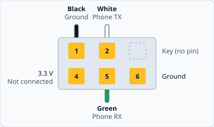

# SSH and serial console

Open DPhone provides a root shell over SSH and on a serial console on the EHS port.  Both are off by default.  The shell is [brush](https://github.com/reubeno/brush), which is Bash-compatible, with the uutils versions of the common utilities, `sed`, and the [`dphone` command](dphone-command.md).

## SSH

The SSH server accepts public keys only; the login name is `root`.  A login requires the SSH setting on and at least one public key on the phone.

### Web interface

On the **System** page, the **SSH** card has the **Enabled** switch, which takes effect immediately, and the list of keys.  To add a key, paste the public key (the contents of a `.pub` file, e.g., `~/.ssh/id_ed25519.pub`) into the box, or choose the file, and click **Add Key**.

The keys are stored in `/nvdata/root/.ssh/authorized_keys`, the file that the stock firmware's SSH server reads.

### PBX configuration

With [Open DPMA](../open-dpma/index.md), the phone section turns SSH on and supplies keys:

```ini
[phone101]
type=phone
dphone_ssh_enabled=yes
dphone_ssh_authorized_key=ssh-ed25519 AAAAC3NzaC1lZDI1NTE5AAAAIAaaaaaaaaaaaaaaaaaaaaaaaaaaaaaaaaaaaaaaaaaa alice@laptop
```

See [Open DPhone options](../open-dpma/open-dphone-options.md#dphone_ssh_enabled).

### Settings file

From an open shell, e.g., on the serial console, set `ssh_enabled: true` in `/nvdata/dphone_settings.txtpb`, the file where the web interface stores the setting, one field per line.  Then reload the configuration.  If the file has no `ssh_enabled` line:

```sh
echo 'ssh_enabled: true' >> /nvdata/dphone_settings.txtpb
dphone config reload
```

If the file has the line, change the value instead of adding a second line.  The serial console's field is `serial_console: true`.

### Login

```sh
ssh root@192.0.2.20
```

The server also runs single commands and serves SFTP, so `scp` and `sftp` work:

```sh
ssh root@192.0.2.20 dphone version
scp root@192.0.2.20:/tmp/screen.ppm .
```

The phone generates an Ed25519 host key on first use and stores the key in nvdata, so the host key survives firmware updates.  The server accepts at most six connections at a time.

Turning SSH off closes the listening socket but not open sessions, so turning SSH off from an SSH session does not end the session.

## Serial console

The phone's serial port is the EHS port, the connector for an electronic hook switch (EHS) headset adapter.  A setting gives the port to either a headset adapter or the console.  With the default setting, Headset, the phone writes nothing to the port: no kernel messages, no shell, and no log output.

### Console mode

On the **System** page of the web interface, set **EHS Port** to **Serial Console (115200 8N1)**; the change takes effect immediately.  From the PBX, set [`dphone_serial_console`](../open-dpma/open-dphone-options.md#dphone_serial_console) in the phone section:

```ini
dphone_serial_console=yes
```

In console mode, the port carries:

- the kernel's console messages,
- a copy of the main role's log, and
- a root shell, with no login prompt.

!!! warning "Console mode gives a root shell to anyone with physical access"

    Switch the setting back to Headset before a phone goes back into service.

The console also takes over the port when the main role fails, whatever the setting: the init role gives the port to the console until a working main role applies the setting again.  A phone whose main role cannot start is reachable with a cable.

### Wiring

Every model has the same EHS header: two rows of three positions on a 1 mm pitch.  One position has no pin and serves as the key.  The diagram shows the header as seen when attaching the cable, with the key at the top right.

{ width="420" }

| Pin | Function | USB serial cable |
| --- | --- | --- |
| 1 | Ground | Ground wire (black) |
| 2 | Phone TX (output from the phone) | Receive wire (white) |
| 3 | Key, no pin | |
| 4 | 3.3 V supply from the phone | Leave unconnected |
| 5 | Phone RX (input to the phone) | Transmit wire (green) |
| 6 | Ground | Alternative to pin 1 for the ground wire |

Use a USB serial cable with 3.3 V logic levels.  The wire colors are typical of cables with four loose wires, but vary between manufacturers; check the cable's documentation.

!!! danger "Do not connect the cable's power wire"

    Pin 4 carries the phone's 3.3 V supply.  Leave the cable's power wire (red, 5 V from the USB port) unconnected.

### Terminal settings

115200 bits per second, 8 data bits, no parity, 1 stop bit (8N1), and no flow control.  For example, with the cable at `/dev/ttyUSB0`:

```sh
picocom -b 115200 /dev/ttyUSB0
```

Press ++enter++ for a prompt.

### Early kernel messages

The firmware applies the console setting, so with the setting alone, kernel messages reach the port only after the main role has started.  The kernel parameter `amba_pl011.console_output=1` makes the kernel write to the port from the start of the boot:

- **For an image booted from RAM**, pass the parameter with [`--append`](test-builds.md#options):

    ```sh
    ssh root@192.0.2.20 dphone ramboot --append amba_pl011.console_output=1 - < result
    ```

- **For an image to install**, add the parameter to the `bootargs` property in `kernel/files/arch/arm/boot/dts/broadcom/bcmring-digium-common.dtsi` and build the image.  The boot loader's part of the kernel command line cannot be changed.
- **On a running phone**, write `1` to `/sys/module/amba_pl011/parameters/console_output`.
