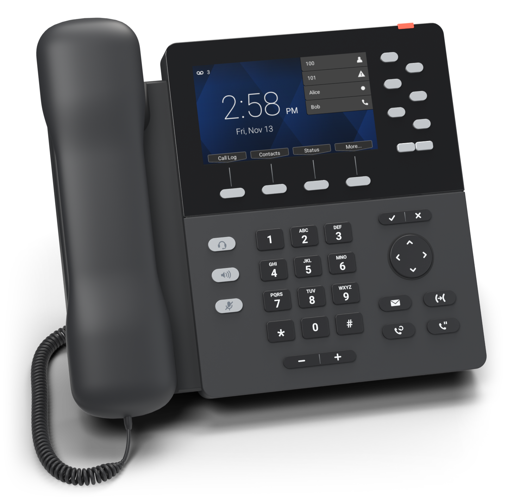

# Open DPhone

Open DPhone is open firmware for the Digium D-series desk phones: the D40, D45, D50, D60, D62, D65, and D70.  The firmware replaces the stock firmware with a mainline Linux kernel and a phone application written in Rust, and is free software under the GNU General Public License, version 2 or later.

<!--
  RENDER: the 3D render of a D65 running Open DPhone goes here.
  When docs/assets/d65-render.png exists, remove this comment's opening
  and closing lines so that the figure below is part of the page.

<figure markdown="span">
  { width="720" }
</figure>
-->

[Download the firmware](https://github.com/jackrosenthal/open-dphone/releases){ .md-button .md-button--primary }
[Install Open DPMA](open-dpma/index.md){ .md-button }

Open DPhone is an independent project, and is not made or endorsed by Digium or Sangoma.

## Who the firmware is for

Open DPhone is for people who have D-series phones in service and want firmware that can be read, changed, and extended.  A phone that runs Open DPhone takes a configuration from a DPMA server, as a phone with stock firmware does, or from SIP accounts entered in the phone's web interface.

## What the firmware provides

- **Apps.**  Apps are WebAssembly components.  Twelve apps are built in: Alarms, Calendar, Contacts, Diagnostics, Hot Desking, Parking, Queues, Status, Voicemail, and the games Box Pusher, Desk Sparrow, and Light Up.  More apps are installed from the phone's web interface, and the [App SDK](app-sdk/index.md) is the way to write one.
- **Themes.**  On the color models (D60, D62, and D65), each built-in wallpaper has a palette that colors every screen.  A provisioning server can supply a wallpaper picture and a palette file to match.
- **A web interface.**  The web interface shows the phone's calls, accounts, contacts, preferences, Bluetooth devices, alarms, apps, network, provisioning, and logs, mirrors the phone's screen, and has a shell.
- **Firmware updates that can be undone.**  An update is written to the firmware bank that is not running, and the running firmware stays in the other bank.  A new image starts on trial, and the phone returns to the previous firmware when the new image does not come up.  The web interface also installs stock firmware images, so a phone can go back to stock firmware.
- **Access for administrators.**  An SSH server with public-key login, a serial console on the EHS port, and a `/metrics` endpoint for monitoring are each switched on or off for every phone.

## Install the firmware

Each [release on GitHub](https://github.com/jackrosenthal/open-dphone/releases) has one firmware image for each model, named `<version>_<model>_firmware.eff` (e.g., `3_0_0_D65_firmware.eff`), and a `SHA256SUMS` file to verify the download.  Choose the image for the phone's model: a phone refuses an image made for another model.

The images are in the format of stock firmware images.  A phone that runs stock firmware therefore installs an Open DPhone image as that phone installs any firmware: from a firmware entry in the DPMA configuration on the PBX, or from the firmware page of the phone's web interface.

## Open DPMA

DPMA, the Digium Phone Module for Asterisk (`res_digium_phone`), is the closed-source Asterisk module that provisions D-series phones and answers the requests of the phones' apps.  The Open DPhone project has reimplemented DPMA in Rust as Open DPMA, an open-source module that takes the place of the original.

Open DPMA reads the same `res_digium_phone.conf`, so an existing configuration works unchanged.  Open DPMA also fixes bugs and security issues of the original module, e.g., phone file requests that can read any file on the server, and inputs that crash Asterisk.

Open DPMA provides features that the original module does not have:

- **Options for Open DPhone phones.**  A phone's section of the configuration can switch the phone's SSH server, serial console, and metrics on or off, list the SSH keys that may log in, set a static network address, choose the softkeys of the idle screen, hide built-in apps, and name a palette file.
- **App data.**  Apps keep data on the PBX, e.g., a game's best times, which every phone then shows.  On a PBX with more than one tenant, each tenant's phones share a separate store.

Each release has pre-built modules for Asterisk 22, 23, and 24 on x86_64 and aarch64.  The [Open DPMA](open-dpma/index.md) section tells an Asterisk administrator how to install, configure, and administer the module.

## Better together, and each usable alone

The firmware and Open DPMA are made to work together, and each also works without the other.

| Firmware on the phone | Module on the PBX | Result |
| --- | --- | --- |
| Open DPhone | Open DPMA | Every feature of both. |
| Open DPhone | The original `res_digium_phone` | The phone is provisioned as a phone with stock firmware is.  The options for Open DPhone phones and app data on the PBX are not available, because the original module has neither. |
| Stock firmware | Open DPMA | The phone works as with the original module, on a module with the bugs and security issues fixed. |

A site can therefore change the phones and the PBX in either order, or change only one of the two.

## Where to go next

- [Open DPMA](open-dpma/index.md), for Asterisk administrators: installing the module, the configuration options, and administration practices.
- [App SDK](app-sdk/index.md), for developers who write apps for the phones: a tutorial in Rust, and the reference for the app interface.
- [Dev Guide](dev-guide/index.md), for developers who change the firmware: building from source, installing and trying firmware images, and debugging a phone.
