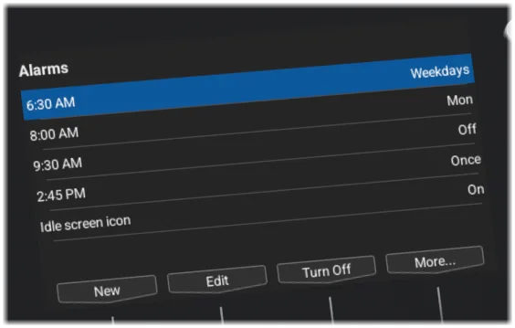
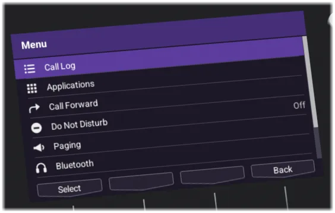
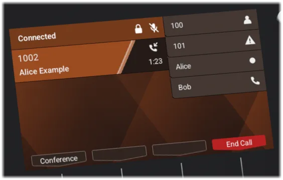

# Open DPhone

Open DPhone is open firmware for the Digium D-series desk phones: the D40, D45, D50, D60, D62, D65, and D70.  The firmware replaces the stock firmware with a mainline Linux kernel and a phone application written in Rust, and is free software under the GNU General Public License, version 2 or later.

<link rel="stylesheet" href="assets/d65-viewer/viewer.css">
<figure class="d65-viewer">
  

    <picture>
      <source srcset="assets/d65-viewer/phone.webp" type="image/webp">
      
    </picture>
    
    
    
    
    
    
    
    
    
    
    
  

  <figcaption>
    The idle screen is shown in the theme Harbor.
    The idle screen is shown in the theme Dusk.
    The idle screen is shown in the theme Sunrise.
    The idle screen is shown in the theme Regatta.
    The Applications menu is shown in the theme Glacier.
    The game Light Up is built in.
    The game Desk Sparrow is built in.
    The game Box Pusher is built in.
    The Alarms app lists the alarms that are set.
    The phone's menu is shown in the theme Amethyst.
    An incoming call is shown in the theme Evergreen.
    A connected call is shown in the theme Ember.
  </figcaption>
</figure>

[Download the firmware](https://github.com/jackrosenthal/open-dphone/releases){ .md-button .md-button--primary }
[Install Open DPMA](open-dpma/index.md){ .md-button }

Open DPhone is an independent project, and is not made or endorsed by Digium or Sangoma.

## Who the firmware is for

Open DPhone is for people who have D-series phones in service and want firmware that can be read, changed, and extended.  A phone that runs Open DPhone is configured by a DPMA server, as a phone with stock firmware is, or by hand: the SIP accounts are entered in the phone's web interface.

## What the firmware provides

- **Apps.**  Apps are WebAssembly components.  Twelve apps are built in: Alarms, Calendar, Contacts, Diagnostics, Hot Desking, Parking, Queues, Status, Voicemail, and the games Box Pusher, Desk Sparrow, and Light Up.  More apps are installed from the phone's web interface, and the [App SDK](app-sdk/index.md) is the way to write one.
- **Themes.**  On the color models (D60, D62, and D65), the user chooses among 42 themes.  A theme is a wallpaper together with a palette that colors every screen, and eight of the wallpapers move slowly on the idle screen.  With Open DPMA, the choice follows the user to another phone and returns after the phone is reset.  A provisioning server can set the theme, or supply a wallpaper picture and a palette file to match.
- **A web interface.**  The web interface shows the phone's calls, accounts, contacts, preferences, Bluetooth devices, alarms, apps, network, provisioning, and logs, mirrors the phone's screen, and has a shell.
- **Firmware updates that can be undone.**  An update is written to the firmware bank that is not running, and the running firmware stays in the other bank.  A new image starts on trial, and the phone returns to the previous firmware when the new image does not come up.  The web interface also installs stock firmware images, so a phone can go back to stock firmware.
- **Access for administrators.**  Each phone has an SSH server with public-key login, a serial console on the EHS port, and a `/metrics` endpoint for monitoring.  Each of the three is switched on or off phone by phone.

## Install the firmware

Each [release on GitHub](https://github.com/jackrosenthal/open-dphone/releases) has one firmware image for each model, named `<version>_<model>_firmware.eff` (e.g., `3_0_0_D65_firmware.eff`), and a `SHA256SUMS` file to verify the download.  Choose the image for the phone's model: a phone refuses an image made for another model.

The images are in the format of stock firmware images.  A phone that runs stock firmware therefore installs an Open DPhone image as that phone installs any firmware: from a firmware entry in the DPMA configuration on the PBX, or from the firmware page of the phone's web interface.  [Moving phones between stock firmware and Open DPhone](open-dpma/administration.md#moving-phones-between-stock-firmware-and-open-dphone) has the firmware entry.

## Open DPMA

A PBX provisions D-series phones, and answers the requests of the phones' apps, over DPMA, the protocol of the Digium Phone Module for Asterisk.  Digium's module, `res_digium_phone`, is closed source.  Open DPMA is an open-source Asterisk module, written in Rust, that speaks DPMA and takes the place of the original `res_digium_phone`.

Open DPMA reads the original module's configuration file, `res_digium_phone.conf`, so an existing configuration works unchanged.  Open DPMA also fixes bugs and security issues of the original module, e.g., phone file requests that can read any file on the server, and inputs that crash Asterisk.

Open DPMA provides features that the original module does not have:

- **Options for Open DPhone phones.**  A phone's section of the configuration can switch the phone's SSH server, serial console, and metrics on or off, list the SSH keys that may log in, set a static network address, choose the softkeys of the idle screen, hide built-in apps, set the theme, and name a palette file for a provisioned wallpaper picture.
- **App data.**  Apps keep data on the PBX, e.g., a game's best times, which every phone then shows, and the phone keeps the user's theme there.  On a PBX with more than one tenant, each tenant's phones share a separate store.

Each release has pre-built modules for Asterisk 22, 23, and 24 on x86_64 and aarch64.

## Better together, and each usable alone

| Firmware on the phone | Module on the PBX | Result |
| --- | --- | --- |
| Open DPhone | Open DPMA | Every feature of both. |
| Open DPhone | The original `res_digium_phone`{ .nowrap } | The phone is provisioned as a phone with stock firmware is.  The options for Open DPhone phones and app data on the PBX are not available, because the original module has neither. |
| Stock firmware | Open DPMA | The phone works as with the original module, on a module with the bugs and security issues fixed. |

A site can therefore change the phones and the PBX in either order, or change only one of the two.

## Where to go next

- [Open DPMA](open-dpma/index.md), for Asterisk administrators: installing the module, the configuration options, and administration practices.
- [App SDK](app-sdk/index.md), for developers who write apps for the phones: a tutorial in Rust, and the reference for the app interface.
- [Dev Guide](dev-guide/index.md), for developers who change the firmware: building from source, installing and trying firmware images, and debugging a phone.
