# Open DPhone

Open DPhone is open-source firmware for the Digium D40, D45, D50, D60, D62, D65, and D70 desk phones: a mainline Linux kernel and a phone application written in Rust.

<link rel="stylesheet" href="assets/phones/viewer.css">

=== "D40"

    
      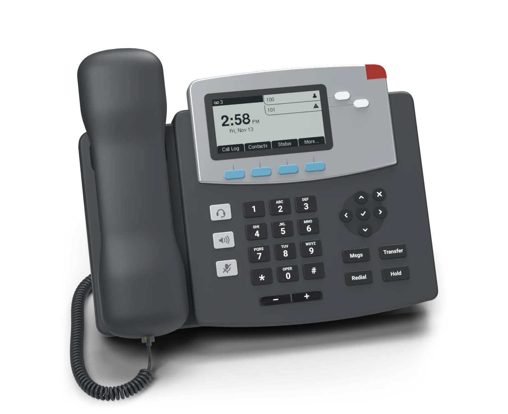
      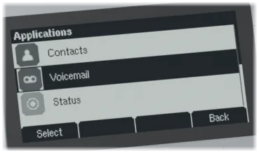
      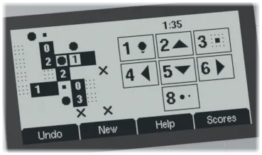
      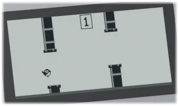
      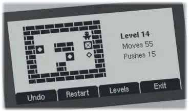
      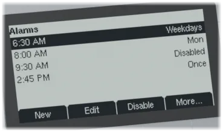
      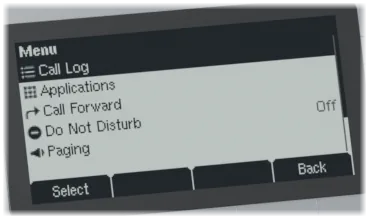
      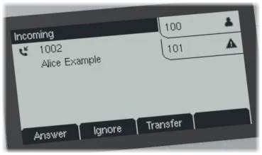
      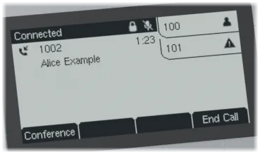
    

=== "D50"

    
      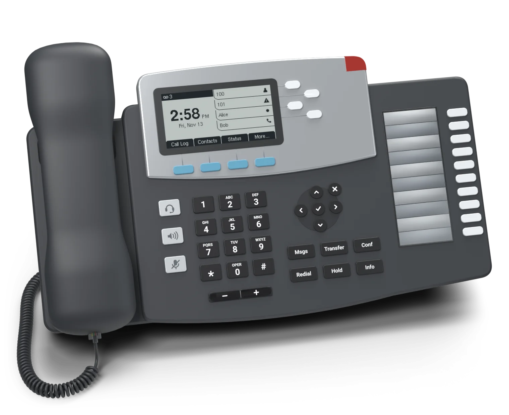
      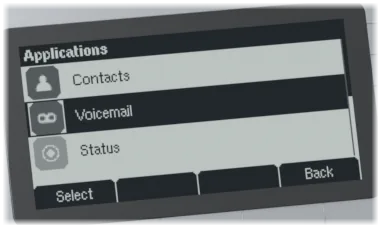
      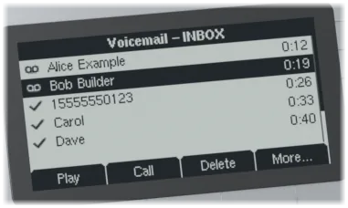
      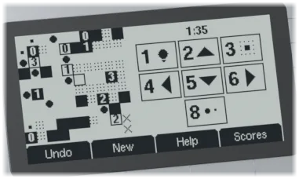
      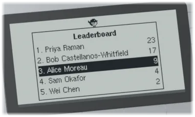
      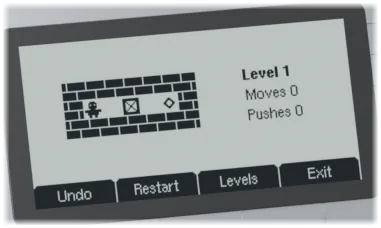
      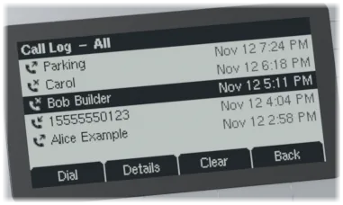
      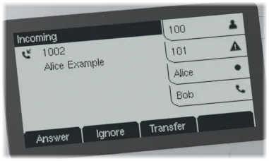
      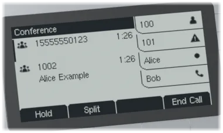
    

=== "D60"

    
      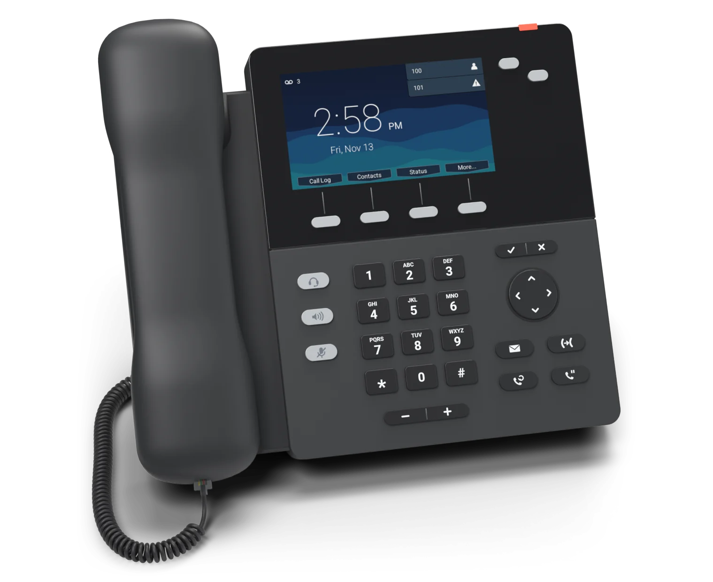
      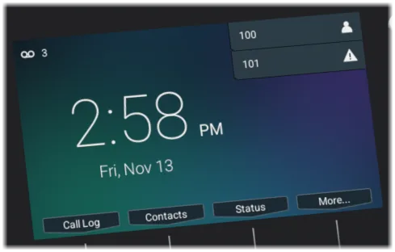
      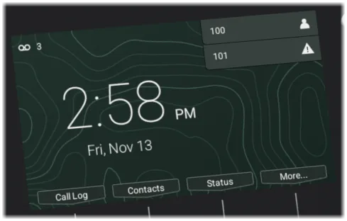
      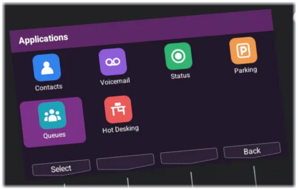
      
      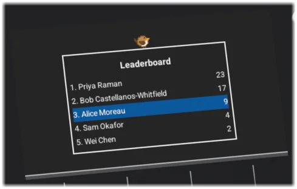
      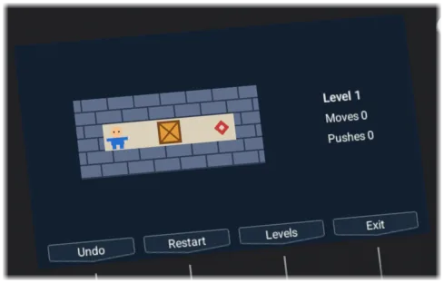
      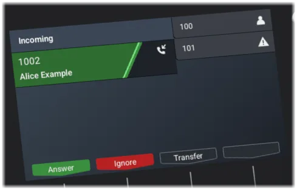
      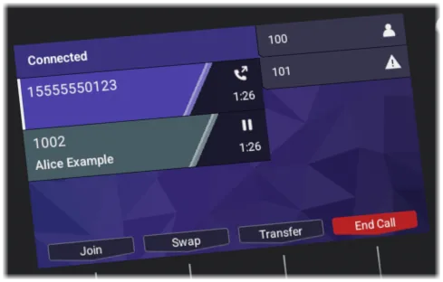
    

===+ "D65"

    
      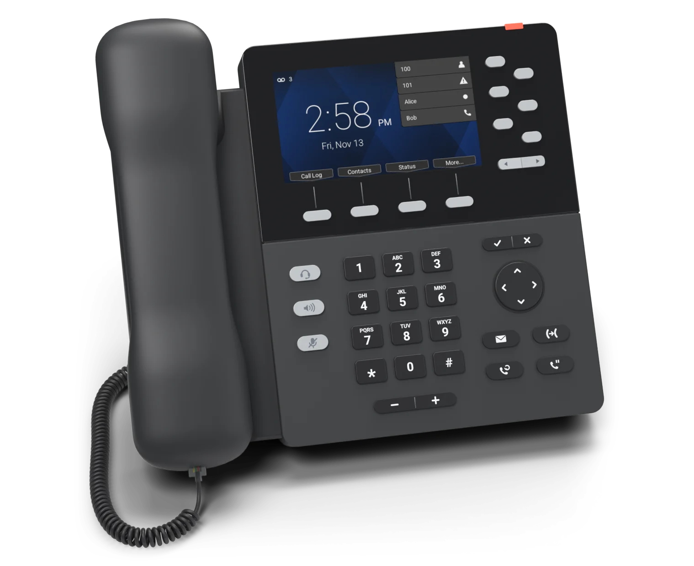
      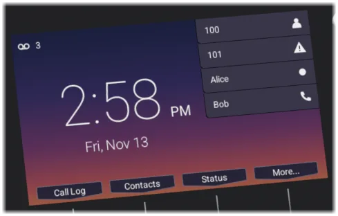
      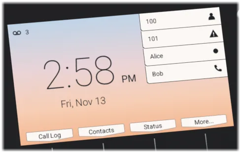
      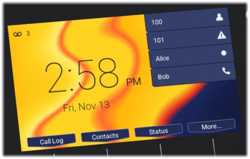
      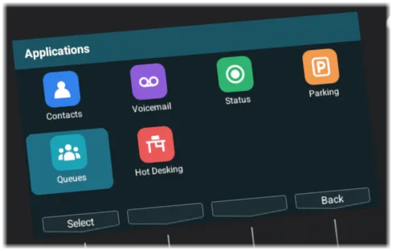
      
      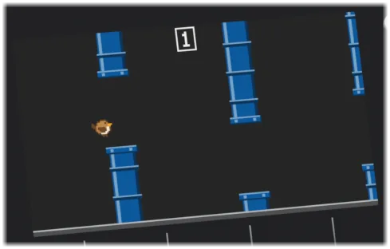
      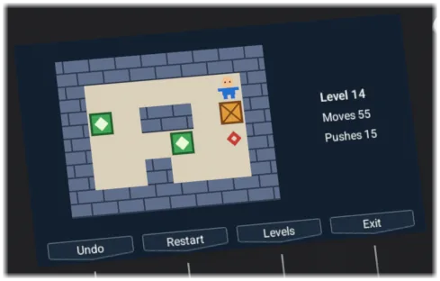
      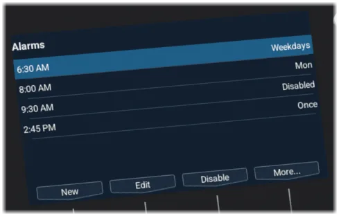
      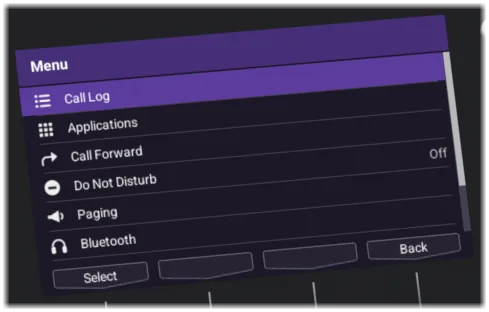
      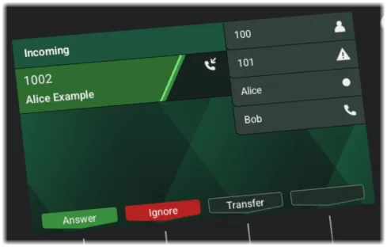
      
    

=== "D70"

    
      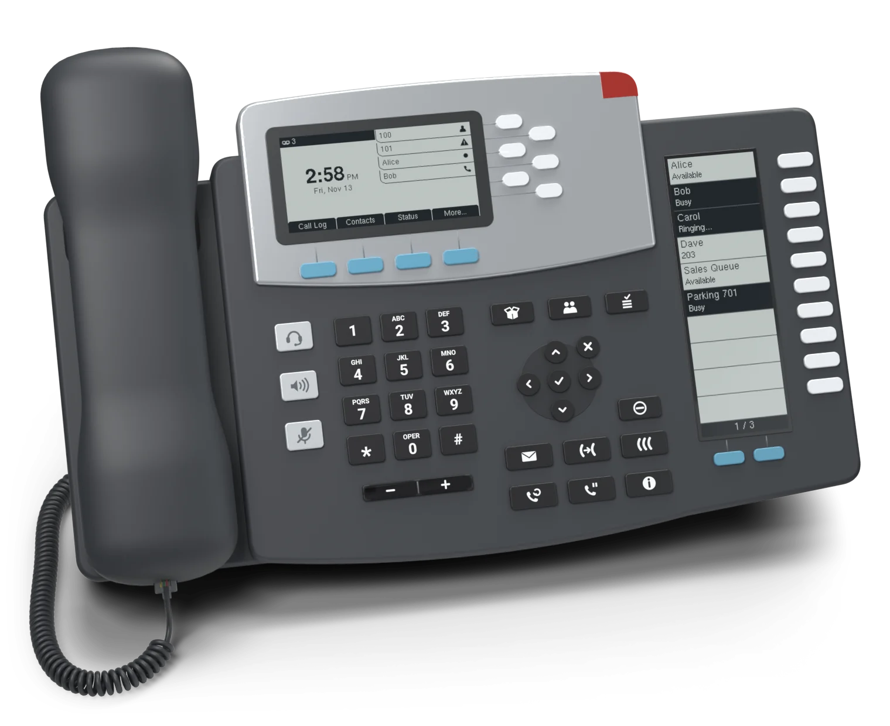
      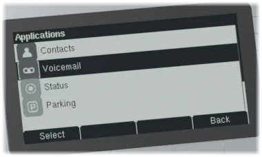
      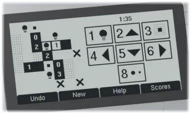
      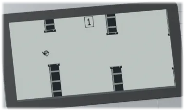
      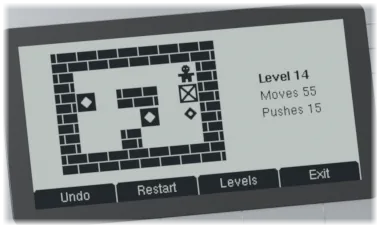
      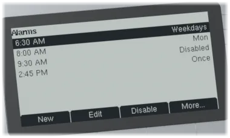
      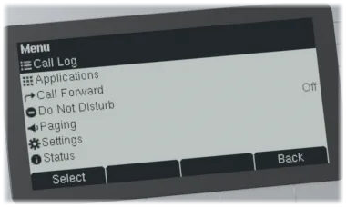
      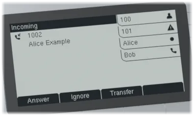
      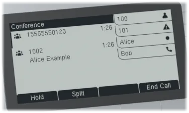
    

Open DPhone is an independent project and is not affiliated with or endorsed by Digium or Sangoma.

## Features

- **Apps.**  Apps are WebAssembly components written in Rust with the [App SDK](app-sdk/index.md).  Each app runs in a sandbox with only the phone interfaces that the app's code calls.  With Open DPMA, apps can store data on the PBX that every phone shares.  The stock firmware's JavaScript apps do not run on Open DPhone.
- **Themes.**  On the D60, D62, and D65, a theme pairs a wallpaper with a color palette for every screen.  With Open DPMA, a user's theme follows the user to other phones and survives a factory reset.
- **Web interface.**  Beyond the stock settings, the web interface manages calls, Bluetooth devices, and alarms, and mirrors the phone's screen.
- **Shell access.**  A root shell is available over SSH, on a serial console on the EHS port, and in the web interface.

## Installation

Download the image for the phone's model, `<version>_<model>_firmware.eff` (e.g., `3_0_0_D65_firmware.eff`), and the `SHA256SUMS` file from the [releases page](https://github.com/jackrosenthal/open-dphone/releases).  A phone rejects an image built for another model.

The images use the stock firmware's image format, so stock firmware installs Open DPhone as a firmware update, from the phone's web interface or through DPMA provisioning.

### Web interface

1. Log in to the phone's web interface.  On a phone provisioned by a DPMA server, the web interface requires `web_ui_enabled=yes` in the phone section of `res_digium_phone.conf`.
2. Go to `http://<phone address>/firmware/`.
3. Choose the `.eff` file under **Firmware File**, then click **Update to this Firmware Version**.

If the DPMA server provisions firmware for the phone's model, the firmware page refuses uploads; install through DPMA provisioning.

### DPMA provisioning

Add a firmware entry for the image to the PBX's DPMA configuration, with Open DPMA or the original `res_digium_phone`; see [Migration between stock firmware and Open DPhone](open-dpma/administration.md#firmware-migration).  The phones install the image at the next configuration fetch.

### After installation

The phone keeps the network settings and the web interface password, and a provisioned phone gets the same configuration from the DPMA server.  Without a DPMA server, add SIP accounts in the web interface.

To return to stock firmware, upload a stock firmware image on the **System** page of the web interface.

## Open DPMA

Open DPMA is an open-source replacement for the original `res_digium_phone` Asterisk module.  Phones running Open DPhone also work with the original module, without app data and the [Open DPhone options](open-dpma/open-dphone-options.md).
