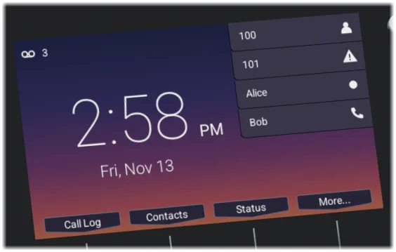
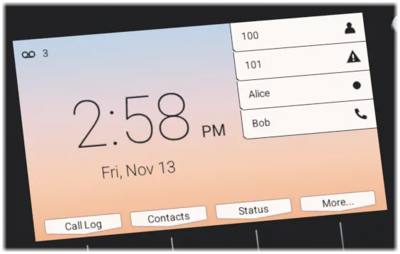
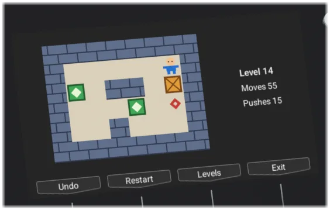
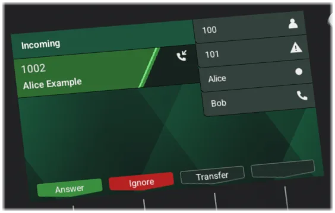

# Open DPhone

Open DPhone is open-source firmware for the Digium D-series desk phones: the D40, D45, D50, D60, D62, D65, and D70.  Open DPhone replaces the stock firmware with a mainline Linux kernel and a phone application written in Rust, and is licensed under the GNU General Public License, version 2 or later.

<link rel="stylesheet" href="assets/d65-viewer/viewer.css">
<figure class="d65-viewer">
  

    <picture>
      <source srcset="assets/d65-viewer/phone.webp" type="image/webp">
      
    </picture>
    
    
    
    
    
    
    
    
    
    
    
  

  <figcaption>
    The idle screen in the Harbor theme.
    The idle screen in the Dusk theme.
    The idle screen in the Sunrise theme.
    The idle screen in the Regatta theme.
    The Applications menu in the Glacier theme.
    Light Up, one of three built-in games.
    Desk Sparrow, one of three built-in games.
    Box Pusher, one of three built-in games.
    The Alarms app.
    The main menu in the Amethyst theme.
    An incoming call in the Evergreen theme.
    An active call in the Ember theme.
  </figcaption>
</figure>

[Download the firmware](https://github.com/jackrosenthal/open-dphone/releases){ .md-button .md-button--primary }
[Install Open DPMA](open-dpma/installation.md){ .md-button }

Open DPhone is an independent project and is not affiliated with or endorsed by Digium or Sangoma.

## Features

- **Apps.**  Twelve apps are built in: Alarms, Calendar, Contacts, Diagnostics, Hot Desking, Parking, Queues, Status, Voicemail, and the games Box Pusher, Desk Sparrow, and Light Up.  Apps are WebAssembly components.  You can install more from the phone's web interface, or write one with the [App SDK](app-sdk/index.md).
- **Themes.**  The color models (D60, D62, and D65) come with 42 themes.  Each theme pairs a wallpaper with a color palette that applies to every screen, and eight of the wallpapers are animated on the idle screen.  With Open DPMA, a user's theme follows the user to other phones and survives a factory reset.  A provisioning server can also set the theme, or supply a custom wallpaper and a matching palette.
- **Web interface.**  Manage calls, accounts, contacts, preferences, Bluetooth devices, alarms, apps, network settings, provisioning, and logs from a browser.  The web interface also mirrors the phone's screen and includes a shell.
- **Safe firmware updates.**  Each update is written to the inactive firmware bank, so the running firmware stays intact.  A new image boots on a trial basis, and the phone rolls back automatically if the new image fails to come up.  The web interface also installs stock firmware images, so a phone can return to stock firmware.
- **Remote administration.**  Every phone has an SSH server with public-key login, a serial console on the EHS port, and a `/metrics` endpoint for monitoring.  Each can be turned on or off per phone.

## Installation

Download the image for your phone's model from the [releases page](https://github.com/jackrosenthal/open-dphone/releases).  Images are named `<version>_<model>_firmware.eff` (e.g., `3_0_0_D65_firmware.eff`), and each release includes a `SHA256SUMS` file for verifying the download.  A phone rejects an image built for a different model.

Open DPhone images use the stock firmware image format, so a phone running stock firmware installs Open DPhone like any other firmware update: from the phone's web interface, or through DPMA provisioning.

### Web interface

1. Log in to the phone's web interface.  On a phone provisioned by a DPMA server, the web interface is available only when the phone's section of `res_digium_phone.conf` has `web_ui_enabled=yes`.
2. Go to `http://<phone address>/firmware/`.
3. Choose the `.eff` file under **Firmware File**, then click **Update to this Firmware Version**.

The phone installs the image and restarts into Open DPhone.

If the DPMA server already provisions firmware for the phone's model, the firmware page does not accept uploads.  Install through DPMA provisioning instead.

### DPMA provisioning

Add a firmware entry for the image to the DPMA configuration on the PBX, and the phones install the image the next time they fetch their configuration.  See [Migration between stock firmware and Open DPhone](open-dpma/administration.md#firmware-migration) for the configuration.  This method works with both Open DPMA and the original `res_digium_phone`.

### After installation

The phone keeps the existing network settings and web interface password, and a provisioned phone picks up the same configuration from the DPMA server as before.  On a phone without a DPMA server, add SIP accounts in the web interface.

The stock firmware remains in the phone's other firmware bank.  To go back, upload a stock firmware image on the **System** page of the Open DPhone web interface.

## Open DPMA

DPMA, the Digium Phone Module for Asterisk, is the protocol that a PBX uses to provision D-series phones and to serve requests from the phones' apps.  Digium's implementation, the `res_digium_phone` module, is closed source.  The Open DPhone project reimplemented DPMA in Rust as Open DPMA, an open-source Asterisk module that is a drop-in replacement for the original `res_digium_phone`.

Open DPMA reads the original module's configuration file, `res_digium_phone.conf`, so existing configurations work unchanged.  Open DPMA also fixes bugs and security issues in the original module, including a path traversal in phone file requests that exposes any file on the server, and malformed requests that crash Asterisk.

Open DPMA adds features that the original module lacks:

- **Open DPhone options.**  A phone's configuration section can enable or disable SSH, the serial console, and metrics; list authorized SSH keys; assign a static network address; choose the idle screen softkeys; hide built-in apps; set the theme; and supply a palette file for a provisioned wallpaper.
- **App data.**  Apps can store data on the PBX, such as a game's best times, which then appear on every phone.  The user's theme is stored the same way.  On a multi-tenant PBX, each tenant's phones share a separate store.

Each release includes prebuilt modules for Asterisk 22, 23, and 24 on x86_64 and aarch64.

## Compatibility

Open DPhone and Open DPMA are better together, but each works without the other.  You can upgrade the phones and the PBX in either order, or upgrade only one.

| Phone firmware | PBX module | Result |
| --- | --- | --- |
| Open DPhone | Open DPMA | Every feature of both. |
| Open DPhone | The original `res_digium_phone`{ .nowrap } | The phone is provisioned like a stock phone.  Open DPhone options and app data on the PBX are unavailable, because the original module supports neither. |
| Stock firmware | Open DPMA | The phone works the same as with the original module, without the original module's bugs and security issues. |
