The firmware's built-in apps use the App SDK.  Each link opens the app's source code.

-   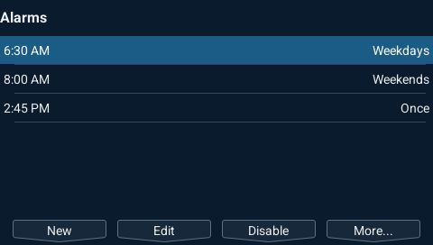

    [Alarms](https://github.com/jackrosenthal/opendeskphone/tree/main/apps/alarms)

-   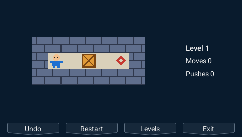

    [Box Pusher](https://github.com/jackrosenthal/opendeskphone/tree/main/apps/boxpusher)

-   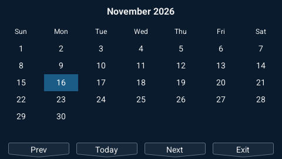

    [Calendar](https://github.com/jackrosenthal/opendeskphone/tree/main/apps/calendar)

-   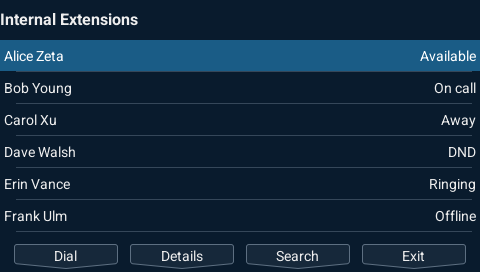

    [Contacts](https://github.com/jackrosenthal/opendeskphone/tree/main/apps/contacts)

-   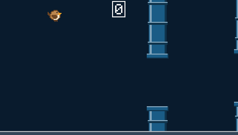

    [Desk Sparrow](https://github.com/jackrosenthal/opendeskphone/tree/main/apps/desksparrow)

-   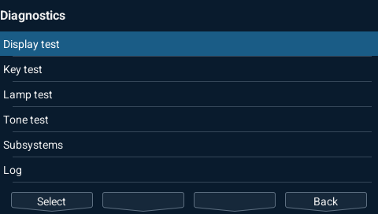

    [Diagnostics](https://github.com/jackrosenthal/opendeskphone/tree/main/apps/diagnostics)

-   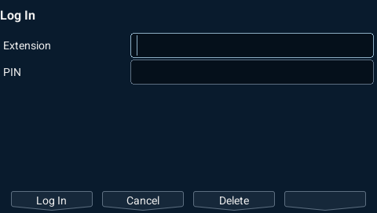

    [Hot Desking](https://github.com/jackrosenthal/opendeskphone/tree/main/apps/hotdesking)

-   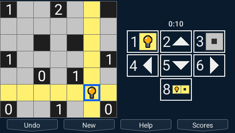

    [Light Up](https://github.com/jackrosenthal/opendeskphone/tree/main/apps/lightup)

-   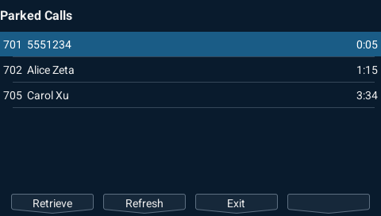

    [Parking](https://github.com/jackrosenthal/opendeskphone/tree/main/apps/parking)

-   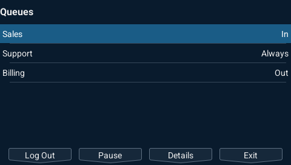

    [Queues](https://github.com/jackrosenthal/opendeskphone/tree/main/apps/queues)

-   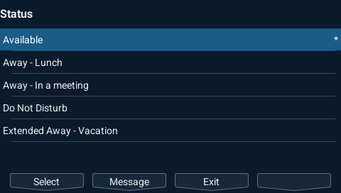

    [Status](https://github.com/jackrosenthal/opendeskphone/tree/main/apps/status)

-   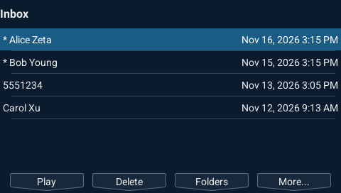

    [Voicemail](https://github.com/jackrosenthal/opendeskphone/tree/main/apps/voicemail)

