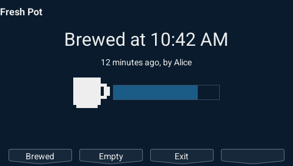

The brew time moves to the PBX.  Pressing **Brewed** on any phone updates every phone, with the name of the person who pressed the key.

<figure class="screenshot">

{ width="480" }

</figure>

## PBX storage

[`storage`](../reference/storage.md) also keeps keys on the PBX.  The PBX locations require a PBX running [Open DPMA](../../open-dpma/index.md) and no configuration.  Fresh Pot uses `StorageLocation::PbxShared`, the keys that every phone running the app shares.

Unlike `Local`:

- **Requests are asynchronous.**  `get`, `set`, and `remove` return `StorageReply::Pending` with a request ID, and the result arrives later as an `Event::Storage` with that ID.
- **The PBX records the author of each entry**, from the user that the writing phone is provisioned for.

## Design

The phone's store remains, as a cache:

1. At startup, the app shows what the phone's store holds and queries the PBX.
2. Each answer from the PBX replaces the state and is saved to the phone's store.
3. **Brewed** and **Empty** update the state, save, and send the change to the PBX.
4. When another phone changes the pot, the PBX notifies this phone, and the app queries the PBX.

Without a PBX store, every request ends in `Unreachable`, and the app behaves as in the previous chapter.

## New state

Both stores use the same key.  Update the constant's comment:

```rust
/// The storage key for the time the pot was brewed, used both on the
/// phone and on the PBX.
const KEY: &str = "brewed";
```

Add two fields to `FreshPot`:

```rust
/// Who brewed the pot, as reported by the PBX.
by: String,
/// The ID of the pending PBX request.
asked: u32,
```

## Requests and responses

Add three functions to `impl FreshPot`:

```rust
/// Requests the brew time from the PBX.
fn ask(&mut self) {
    self.wait_for(storage::get(StorageLocation::PbxShared, KEY));
}

/// Notes the ID of a request to the PBX, whose answer arrives as an
/// `Event::Storage`.
fn wait_for(&mut self, reply: StorageReply) {
    if let StorageReply::Pending(id) = reply {
        self.asked = id;
    }
}

/// Applies the PBX's answer: the key's entry, or `None` if the key
/// isn't set.
fn take(&mut self, entry: Option<StorageEntry>) {
    self.brewed = entry
        .as_ref()
        .and_then(|e| str::from_utf8(&e.value).ok()?.parse().ok());
    self.by = entry.map(|e| e.author_name).unwrap_or_default();
    self.save();
}
```

A [`StorageEntry`](../reference/storage.md#outcomes) holds the bytes that a phone wrote in `value` (here, the time as text), and the writer's name, as recorded by the PBX, in `author_name`.

In `show`, replace the line that sets the text of `self.age` with:

```rust
let mut age = age_text(minutes);
if !self.by.is_empty() {
    age = format!("{age}, by {}", self.by);
}
ui::set_text(self.age, &age);
```

## Startup

At the end of `start`, after rendering what the phone's store holds, subscribe to changes and query the PBX:

```rust
self.load();
self.show();

storage::watch(true);
self.ask();
```

After [`storage::watch(true)`](../reference/storage.md#watch), the app receives `Event::StorageChanged` whenever another phone sets or removes one of the app's `PbxShared` keys, while the app runs.

## Event handling

Replace `handle` with:

```rust
fn handle(&mut self, event: Event) {
    match event {
        Event::Softkey(SK_BREWED) => {
            let now = timers::wall_time();
            self.brewed = Some(now);
            self.by = storage::user().map(|user| user.name).unwrap_or_default();
            self.save();
            self.wait_for(storage::set(
                StorageLocation::PbxShared,
                KEY,
                now.to_string().as_bytes(),
                None,
            ));
            log_info("a pot was brewed");
        }
        Event::Softkey(SK_EMPTY) => {
            self.brewed = None;
            self.save();
            self.wait_for(storage::remove(StorageLocation::PbxShared, KEY, None));
        }
        Event::Storage((id, outcome)) if id == self.asked => match outcome {
            StorageOutcome::Entry(entry) => self.take(entry),
            StorageOutcome::Stored(entry) => self.take(Some(entry)),
            StorageOutcome::Removed => self.take(None),
            // Keep showing what the phone's store holds.
            StorageOutcome::Unreachable(why) => log_info(&format!("not shared: {why}")),
            other => log_warn(&format!("unexpected answer from the PBX: {other:?}")),
        },
        // Another phone changed the key, or the PBX is reachable again.
        Event::StorageChanged(_) | Event::StorageOnline => return self.ask(),
        Event::Softkey(SK_EXIT) => return runtime::exit(),
        Event::Key(Key::Cancel) => return runtime::exit(),
        // On a timer tick, or when the window returns to the screen
        // (possibly with a new theme's colors), fall through and redraw.
        Event::Timer(_) | Event::Foreground => {}
        _ => return,
    }
    self.show();
}
```

The softkeys also write to the PBX.  For **Brewed**, [`storage::user`](../reference/storage.md#user) supplies the user's name before the PBX answers.  The last argument of `set`, `None`, makes the write unconditional: the latest press wins.

The new arms:

- `Event::Storage` answers a request.  The guard `id == self.asked` ignores all but the latest request.  `Entry` answers `get`, `Stored` answers `set` with the entry as stored, and `Removed` answers `remove`.  `Unreachable` means that the request didn't reach the PBX or the PBX didn't answer.  Of the other outcomes, only `Refused` can follow these requests; the app logs a warning.
- `Event::StorageChanged` carries no value, so the app queries the PBX.
- `Event::StorageOnline` means that the PBX is reachable, for the first time or again.  Earlier reads may be stale, so the app queries the PBX.

:::note[Pressing Brewed while the PBX is unreachable]
The phone doesn't queue failed writes.  The press shows only on that phone, and the PBX's value returns when the PBX is back.
:::

## Build and run

[Build](first-app.md#build) the app, and install the app on two phones on the same PBX.  Open the app on both, and press **Brewed** on one.  The other shows the same time and the first phone's user.  **Empty** on either phone returns both to "No pot".

With one phone, the second line shows that phone's user after **Brewed**.  Without a PBX store, the **Logs** page shows `not shared:` and the reason.

<details>
<summary>Complete <code>src/lib.rs</code> for this chapter</summary>

```rust
use opendeskphone_app_sdk::canvas::{self, Bitmap, Op, Role};
use opendeskphone_app_sdk::prelude::*;
use opendeskphone_app_sdk::{Align, Font, log_info, log_warn, read_string};

const SK_BREWED: u32 = 1;
const SK_EMPTY: u32 = 2;
const SK_EXIT: u32 = 3;

/// How often the screen refreshes, in milliseconds.
const REFRESH_MS: u32 = 30_000;

/// The storage key for the time the pot was brewed, used both on the
/// phone and on the PBX.
const KEY: &str = "brewed";

/// A pot is stale after this many minutes.
const FRESH_MINUTES: u64 = 60;

/// A mug, 12 pixels wide and 10 pixels tall.  Each row is two bytes, and
/// the leftmost pixel is the high bit of the first byte.
#[rustfmt::skip]
const MUG: [u8; 20] = [
    0b1111_1111, 0b1000_0000,
    0b1111_1111, 0b1000_0000,
    0b1111_1111, 0b1110_0000,
    0b1111_1111, 0b1011_0000,
    0b1111_1111, 0b1011_0000,
    0b1111_1111, 0b1011_0000,
    0b1111_1111, 0b1110_0000,
    0b1111_1111, 0b1000_0000,
    0b1111_1111, 0b1000_0000,
    0b0111_1111, 0b0000_0000,
];

#[derive(Default)]
struct FreshPot {
    /// When the pot was brewed, in seconds since the Unix epoch.
    brewed: Option<u64>,
    /// Who brewed the pot, as reported by the PBX.
    by: String,
    /// The ID of the pending PBX request.
    asked: u32,
    /// The line that shows when the pot was brewed.
    status: Widget,
    /// The line that shows how long ago that was.
    age: Widget,
    /// The canvas below the two lines of text, and the canvas dimensions.
    gauge: Widget,
    gauge_width: u16,
    gauge_height: u16,
}

impl FreshPot {
    /// Loads the brew time from the phone's store.
    fn load(&mut self) {
        self.brewed = read_string(KEY).and_then(|text| text.parse().ok());
    }

    /// Saves the brew time to the phone's store.
    fn save(&self) {
        let reply = match self.brewed {
            Some(at) => storage::set(StorageLocation::Local, KEY, at.to_string().as_bytes(), None),
            None => storage::remove(StorageLocation::Local, KEY, None),
        };
        match reply {
            StorageReply::Done(StorageOutcome::Stored(_) | StorageOutcome::Removed) => {}
            other => log_warn(&format!("couldn't store the brew time: {other:?}")),
        }
    }

    /// Requests the brew time from the PBX.
    fn ask(&mut self) {
        self.wait_for(storage::get(StorageLocation::PbxShared, KEY));
    }

    /// Notes the ID of a request to the PBX, whose answer arrives as an
    /// `Event::Storage`.
    fn wait_for(&mut self, reply: StorageReply) {
        if let StorageReply::Pending(id) = reply {
            self.asked = id;
        }
    }

    /// Applies the PBX's answer: the key's entry, or `None` if the key
    /// isn't set.
    fn take(&mut self, entry: Option<StorageEntry>) {
        self.brewed = entry
            .as_ref()
            .and_then(|e| str::from_utf8(&e.value).ok()?.parse().ok());
        self.by = entry.map(|e| e.author_name).unwrap_or_default();
        self.save();
    }

    /// Renders the state to the screen.
    fn show(&self) {
        match self.brewed {
            Some(at) => {
                let minutes = timers::wall_time().saturating_sub(at) / 60;
                ui::set_text(
                    self.status,
                    &format!("Brewed at {}", l10n::format_time(at, TimeStyle::Time)),
                );
                let mut age = age_text(minutes);
                if !self.by.is_empty() {
                    age = format!("{age}, by {}", self.by);
                }
                ui::set_text(self.age, &age);
            }
            None => {
                ui::set_text(self.status, "No pot");
                ui::set_text(self.age, "Press Brewed after making coffee.");
            }
        }
        if let Err(e) = canvas::draw(self.gauge, &self.gauge_ops()) {
            log_warn(&format!("couldn't draw the gauge: {e}"));
        }
    }

    /// The drawing operations for the canvas: a mug, and a bar that empties
    /// as the pot goes stale.  With no pot, the canvas is empty.
    fn gauge_ops(&self) -> Vec<Op> {
        let Some(at) = self.brewed else {
            return Vec::new();
        };
        let minutes = timers::wall_time().saturating_sub(at) / 60;
        let fresh = FRESH_MINUTES.saturating_sub(minutes);

        // Scale the mug to the height of the canvas.
        let scale = (self.gauge_height / 10).clamp(1, 8);
        let mug_width = 12 * scale;
        let mug = Bitmap {
            x: 0,
            y: 0,
            width: 12,
            height: 10,
            scale: scale as u8,
            color: canvas::theme_color(Role::Foreground),
            bits: MUG.to_vec(),
        };

        // The bar takes up the remaining width: a one-pixel frame, filled
        // in proportion to the time left in the hour.
        let x = (mug_width + scale) as i16;
        let y = (self.gauge_height / 4) as i16;
        let width = self.gauge_width - mug_width - scale;
        let height = self.gauge_height / 2;
        let filled = ((width - 2) as u64 * fresh / FRESH_MINUTES) as u16;
        let right = x + width as i16 - 1;
        let bottom = y + height as i16 - 1;
        let border = canvas::theme_color(Role::Border);
        vec![
            Op::Bitmap(mug),
            Op::Fill((Rect::new(x, y, width, 1), border)),
            Op::Fill((Rect::new(x, bottom, width, 1), border)),
            Op::Fill((Rect::new(x, y, 1, height), border)),
            Op::Fill((Rect::new(right, y, 1, height), border)),
            Op::Fill((
                Rect::new(x + 1, y + 1, filled, height - 2),
                canvas::theme_color(Role::Highlight),
            )),
        ]
    }
}

fn age_text(minutes: u64) -> String {
    match minutes {
        0 => "Just now".to_string(),
        1 => "1 minute ago".to_string(),
        m if m < 60 => format!("{m} minutes ago"),
        m => format!("{} h {} min ago", m / 60, m % 60),
    }
}

impl App for FreshPot {
    fn start(&mut self) {
        let area = screen("Fresh Pot");
        let line = ui::get_metrics().line_height;

        self.status = ui::create(
            WidgetKind::Text,
            ROOT,
            Rect::new(0, area.y, area.width, 2 * line),
        );
        ui::set_font(self.status, Font::Large);
        ui::set_align(self.status, Align::Center);

        self.age = ui::create(
            WidgetKind::Text,
            ROOT,
            Rect::new(0, area.y + 2 * line as i16, area.width, line),
        );
        ui::set_align(self.age, Align::Center);

        // The canvas is half the width of the window, centered, and two
        // lines tall.
        self.gauge_width = area.width / 2;
        self.gauge_height = 2 * line;
        let bounds = Rect::new(
            (area.width / 4) as i16,
            area.y + (3 * line + line / 2) as i16,
            self.gauge_width,
            self.gauge_height,
        );
        self.gauge = canvas::create(ROOT, bounds);

        ui::set_softkeys(
            ROOT,
            &[
                Softkey::new(SK_BREWED, "Brewed"),
                Softkey::new(SK_EMPTY, "Empty"),
                Softkey::new(SK_EXIT, "Exit"),
            ],
        );
        let _ = timers::set(REFRESH_MS, true);
        self.load();
        self.show();

        storage::watch(true);
        self.ask();
    }

    fn handle(&mut self, event: Event) {
        match event {
            Event::Softkey(SK_BREWED) => {
                let now = timers::wall_time();
                self.brewed = Some(now);
                self.by = storage::user().map(|user| user.name).unwrap_or_default();
                self.save();
                self.wait_for(storage::set(
                    StorageLocation::PbxShared,
                    KEY,
                    now.to_string().as_bytes(),
                    None,
                ));
                log_info("a pot was brewed");
            }
            Event::Softkey(SK_EMPTY) => {
                self.brewed = None;
                self.save();
                self.wait_for(storage::remove(StorageLocation::PbxShared, KEY, None));
            }
            Event::Storage((id, outcome)) if id == self.asked => match outcome {
                StorageOutcome::Entry(entry) => self.take(entry),
                StorageOutcome::Stored(entry) => self.take(Some(entry)),
                StorageOutcome::Removed => self.take(None),
                // Keep showing what the phone's store holds.
                StorageOutcome::Unreachable(why) => log_info(&format!("not shared: {why}")),
                other => log_warn(&format!("unexpected answer from the PBX: {other:?}")),
            },
            // Another phone changed the key, or the PBX is reachable again.
            Event::StorageChanged(_) | Event::StorageOnline => return self.ask(),
            Event::Softkey(SK_EXIT) => return runtime::exit(),
            Event::Key(Key::Cancel) => return runtime::exit(),
            // On a timer tick, or when the window returns to the screen
            // (possibly with a new theme's colors), fall through and redraw.
            Event::Timer(_) | Event::Foreground => {}
            _ => return,
        }
        self.show();
    }
}

opendeskphone_app_sdk::export_app! {
    app: FreshPot,
    name: "freshpot",
    display_name: "Fresh Pot",
    description: "When the office coffee was brewed",
}
```

</details>
